# Manual da GCS (Aero GCS)

Guia de uso da estação de solo web: o que cada aba faz, como mover os alvos (manual e
automaticamente), como usar cenários e como limpar a simulação depois. A arquitetura e o
acesso remoto estão no [README §19](../README.md#19-estação-de-solo-web-gcs).

Endereço local: `http://localhost:8080` (porta configurável em `~/.config/aero_gcs/settings.json`;
rede local: `https://<ip>:8443` + token). Para subir e abrir com um comando: `./ros2_ws/gcs.sh open`
(ou o atalho "Aero GCS" do menu, criado por `./ros2_ws/gcs.sh install-launcher`).

**Várias GCSs.** Cada computador tem a sua GCS, independente das outras (`/` abre direto a
interface). Para escolher entre elas a partir de outro computador, use o lançador
(`launcher/aero_launcher.py`): ele lista as GCSs que acha na rede e abre a clicada. Ver
[COMANDOS.md](COMANDOS.md#3-lançador-computador-de-acesso).

**Gravar a sessão.** O botão **⏺ Gravar** no topo grava a aba da GCS em vídeo (o navegador
pergunta o que compartilhar) e baixa um MP4/WebM quando você clica em ⏹. Exige `https` ou
`localhost`.

**Sumário.** [Instalação e o comando `aero`](#5-instalação-e-o-comando-aero) ·
[Tour ilustrado](#tour-ilustrado) · [Fluxo básico](#1-fluxo-básico) · [Abas](#2-abas-na-ordem-em-que-aparecem) ·
[Centralização do alvo](#3-modos-de-controle-centralização-do-alvo) ·
[Estudos em lote e em cascata](#6-estudos-em-lote-e-em-cascata) · [Replay de sessão](#7-replay-de-sessão) ·
[Perseguidor remoto](#8-perseguidor-remoto-raspberry-pi) · [Gazebo ou Isaac Sim](#9-gazebo-ou-isaac-sim) ·
[Problemas comuns](#10-problemas-comuns)

A primeira parte (**Tour ilustrado**) mostra cada área da tela com capturas anotadas; as seções
numeradas depois dela são a referência detalhada.

**Idioma**: a interface abre em inglês (padrão). O seletor `EN | PT-BR` no cabeçalho troca para
português; a escolha fica salva no navegador (`localStorage`, chave `gcs.lang`). A tradução é feita em
`web/js/i18n.js` (dicionário PT → EN e padrões para textos dinâmicos); textos novos da interface devem
ganhar uma entrada lá.

---

## Tour ilustrado

Capturas reais da GCS (interface em PT-BR, simulação rodando com o X4 em oito e o perseguidor em
TRACKING). Os números em vermelho correspondem às listas abaixo de cada imagem.

**Editar as figuras.** Cada figura em [`docs/manual_gcs/`](manual_gcs/) é um `.drawio.svg`: um SVG comum
(o GitHub, o VS Code e o navegador mostram) que também é um diagrama do draw.io. Abra no
[draw.io desktop](https://github.com/jgraph/drawio-desktop/releases), em app.diagrams.net ou na extensão
*Draw.io Integration* do VS Code (`hediet.vscode-drawio`, abre o arquivo direto ao clicar). Há duas
camadas: **Screenshot** (a captura, travada) e **Anotações** (caixas, setas e números, editáveis; as setas
ficam presas às caixas ao movê-las). Para trocar só a captura: destrave a camada Screenshot
(painel *Camadas*), selecione a imagem e use *Editar imagem*. Salvar regrava o SVG, que continua
aparecendo neste manual. Para o LaTeX: *Arquivo → Exportar como → PDF*.

**Refazer todas as capturas** (quando a interface mudar): suba a simulação com
`SCENARIO=$PWD/docs/manual_gcs/tools/manual_demo.yaml ./ros2_ws/sim_manager.sh start`, abra a GCS e rode
`python3 docs/manual_gcs/tools/shots.py [nomes...]` (`GCS_URL` se a porta não for 8080). As posições das
setas ficam em `tools/shotlist.py`; o script regrava os `.drawio.svg`, então ajustes manuais feitos no
draw.io nessas figuras se perdem (refaça só as que mudaram).

### T1. Visão geral da tela

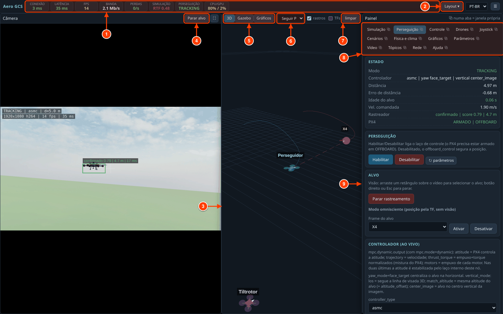

1. **Barra de indicadores** (detalhe em T2): conexão, vídeo, simulação, perseguição e carga da máquina.
2. **Cabeçalho**: menu **Layout ▾**, seletor de idioma **EN | PT-BR** e **☰** (mostra/oculta o painel).
3. **Câmera do perseguidor** (detalhe em T3): vídeo ao vivo com a caixa do rastreador e o HUD.
4. **Parar alvo**: solta o rastreamento (equivale a Esc ou botão direito sobre o vídeo).
5. **Seletor de vista**: **3D** (cena reconstruída das TFs), **Gazebo** (câmera livre do simulador) e
   **Gráficos** (séries ao vivo).
6. **Seguir**: a câmera 3D acompanha um drone (ou fica livre).
7. **rastros / TFs / limpar**: liga os rastros, mostra os eixos de todas as TFs, apaga os rastros.
8. **Abas do painel** (detalhe a partir de T6). O **⧉** ao lado de cada aba abre a aba numa janela própria.
9. **Conteúdo da aba ativa** (aqui, Perseguição).

### T2. Barra de indicadores

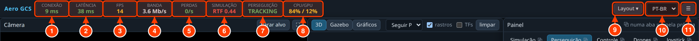

| Nº | Indicador | Leitura |
|---|---|---|
| 1 | **Conexão** | RTT do WebSocket de controle (passe o mouse: *jitter*) |
| 2 | **Latência** | Atraso do vídeo da câmera ao navegador (tooltip: codificação, rede, decodificação, p95) |
| 3 | **FPS** | Quadros desenhados por segundo |
| 4 | **Banda** | Taxa do vídeo recebido |
| 5 | **Perdas** | Quadros descartados por segundo no streamer |
| 6 | **Simulação** | `RTF x.xx` (fator de tempo real), `parada` ou a operação em andamento |
| 7 | **Perseguição** | Modo do supervisor: TRACKING / APPROACH / COASTING / LOST / DISABLED |
| 8 | **CPU/GPU** | Uso da máquina que roda a simulação |
| 9 | **Layout ▾** | Livre/Clássico, presets e janelas (ver T5) |
| 10 | **EN / PT-BR** | Idioma da interface (salvo no navegador; recarrega a página) |
| 11 | **☰** | Mostra/oculta o painel de abas |

Cores: verde = bom, amarelo = atenção, vermelho = problema, cinza = sem dado.

### T3. Câmera do perseguidor

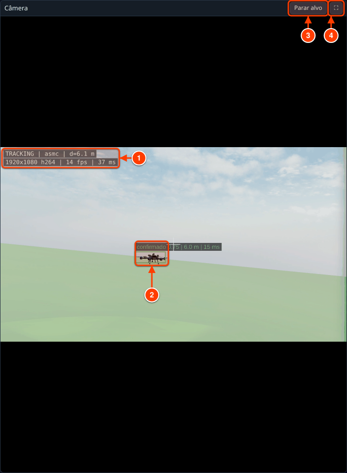

1. **HUD**: modo do supervisor, controlador e distância medida; resolução, codec, fps e latência.
2. **Caixa do rastreador**: estado (`confirmando` em laranja; `confirmado` em verde com profundidade e
   azul sem profundidade), *score*, distância e tempo de inferência.
3. **Parar alvo**: encerra o rastreamento.
4. **⛶**: tela cheia.

Para **escolher o alvo** pela visão, arraste um retângulo sobre o drone no vídeo. Botão direito ou Esc
soltam o alvo. Com `acquisition: auto` (cenários) a caixa é proposta sozinha.

### T4. Vista 3D

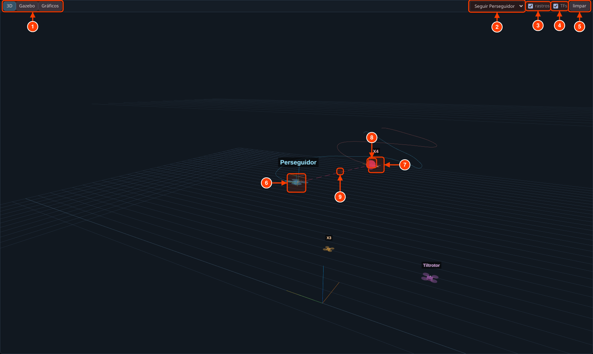

1. **3D / Gazebo / Gráficos**: troca a vista central.
2. **Seguir**: centraliza a câmera 3D no drone escolhido (aqui, *Seguir Perseguidor*). Arrastar gira,
   roda aproxima, botão direito desloca.
3. **rastros**: trajetória recente de cada drone (azul = perseguidor, vermelho = alvo).
4. **TFs**: eixos de todos os frames (`camera_link`, `camera_optical`, `x500_depth_0_enu`,
   `target_estimate`...). Vermelho = x, verde = y, azul = z.
5. **limpar**: apaga os rastros.
6. **Perseguidor** (x500_depth). O cone branco indica o nariz (+x do corpo).
7. **Alvo** (X4) pela TF do Gazebo (verdade).
8. **Estimativa do alvo** (esfera rosa, `/target_3d_state_filtered`): onde o estimador acha que o alvo
   está. A diferença para o item 7 é o erro de estimação.
9. **Linha de visada** (tracejada) do perseguidor até a estimativa.

Com o MPC ativo aparece também a **trajetória prevista** (linha amarela, `/pursuit/predicted_path`).
Drones de cenário são coloridos pelo papel (alvo vermelho, perseguidor azul).

### T5. Vista Gazebo, gráficos e layout

A vista da câmera livre se chama **Gazebo** ou **Isaac**, conforme o simulador da estação. O
slider **FPS** da barra dela (0 a 30) limita o vídeo extraído; em 0 a câmera desliga. No Isaac
Sim, a câmera livre custa ~7 % do RTF enquanto estiver ligada, qualquer que seja o FPS.


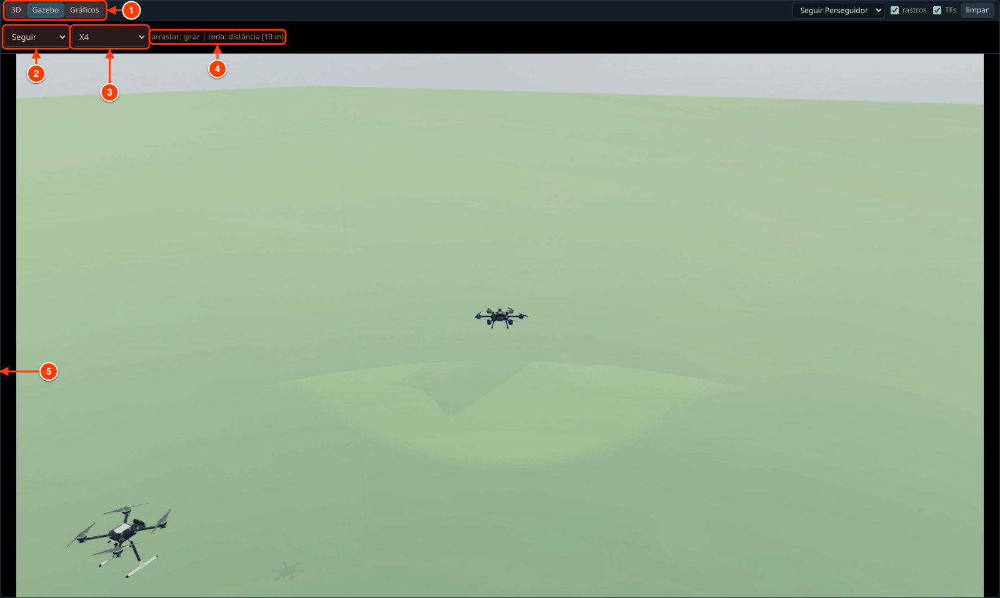

1. Vista **Gazebo** selecionada (o vídeo só é gerado enquanto esta vista está aberta).
2. **Modo da câmera livre**: *Livre* (WASD/QE movem, arrastar olha), *Seguir*, *Orbitar*, *Olhar para*.
3. **Drone de referência** dos modos Seguir/Orbitar/Olhar.
4. **Dica dos comandos** do modo atual (com a velocidade ou a distância atual da câmera).
5. Imagem renderizada pelo Gazebo.

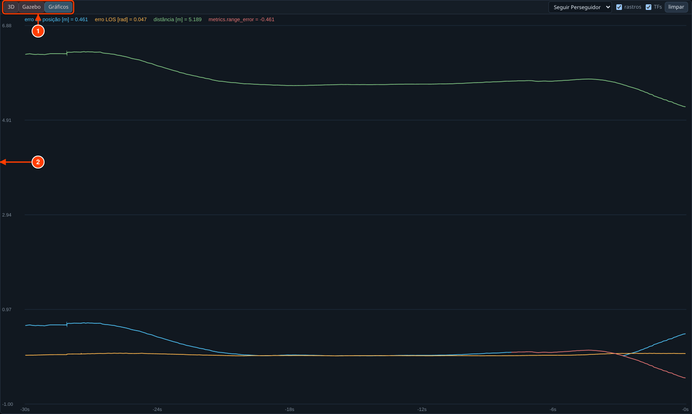

1. Vista **Gráficos** selecionada.
2. Curvas das séries escolhidas na aba Gráficos (T15), com o último valor na legenda.

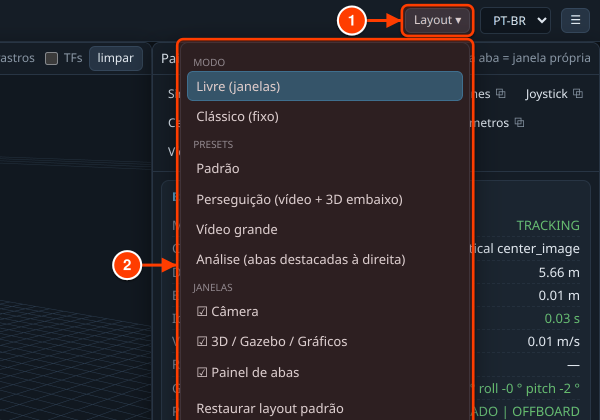

1. **Layout ▾** abre o menu.
2. **Modo** (Livre = janelas arrastáveis; Clássico = layout fixo), **presets** (Padrão, Perseguição,
   Vídeo grande, Análise), quais **janelas** aparecem e **Restaurar layout padrão**.

Janelas encostadas dividem a borda: ao redimensionar uma, a vizinha encolhe ou ocupa o espaço que sobrou
(detalhes em §0).

### T6. Aba Simulação

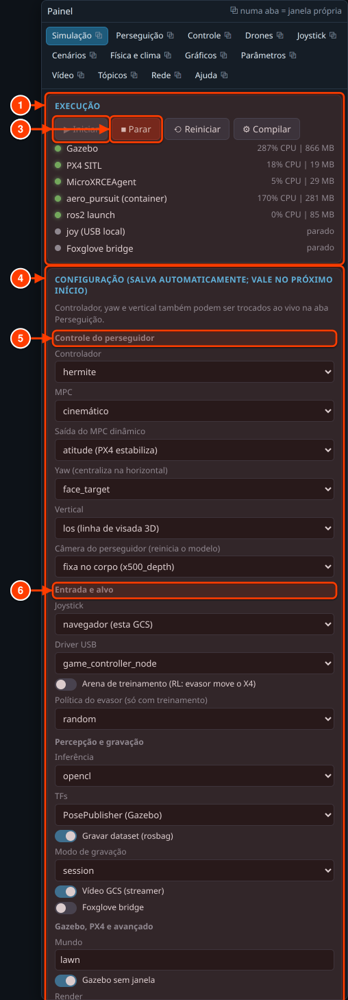

1. **Execução**: estado dos processos (Gazebo, PX4, XRCE, container ROS...) com CPU e memória.
2. **▶ Iniciar** sobe a simulação; **⟲ Reiniciar** e **⚙ Compilar** ficam ao lado.
3. **■ Parar** derruba tudo.
4. **Configuração da partida** (salva sozinha; vale na próxima partida).
5. *Controle do perseguidor*: controlador, modo do MPC, saída do MPC dinâmico, yaw, vertical e
   **Câmera do perseguidor** (fixa no corpo ou gimbal de 3 eixos; trocar reinicia o modelo).
6. *Entrada e alvo*: joystick, driver USB, arena de treinamento e política do evasor.

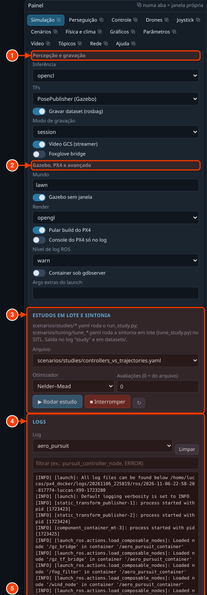

1. *Percepção e gravação*: inferência (cpu/opencl), fonte das TFs, rosbag, vídeo, Foxglove.
2. *Gazebo, PX4 e avançado*: mundo, headless, render, build do PX4, nível de log, gdb, args extras.
3. **Estudos em lote e sintonia**: escolhe um `scenarios/studies/*.yaml` ou `scenarios/tuning/tune_*.yaml`,
   o otimizador e o número de avaliações; **▶ Rodar estudo** / **■ Interromper**. Abaixo, a fila da
   **cascata** (§6) e o **Replay de sessão** (§7). No topo da Execução ficam o seletor de simulador
   (§9) e, com o perseguidor remoto, o quadro da Pi (§8).
4. **Logs** ao vivo de cada processo, com filtro de texto.
5. **Console do PX4** (`commander ...`, `listener ...`).

### T7. Aba Perseguição

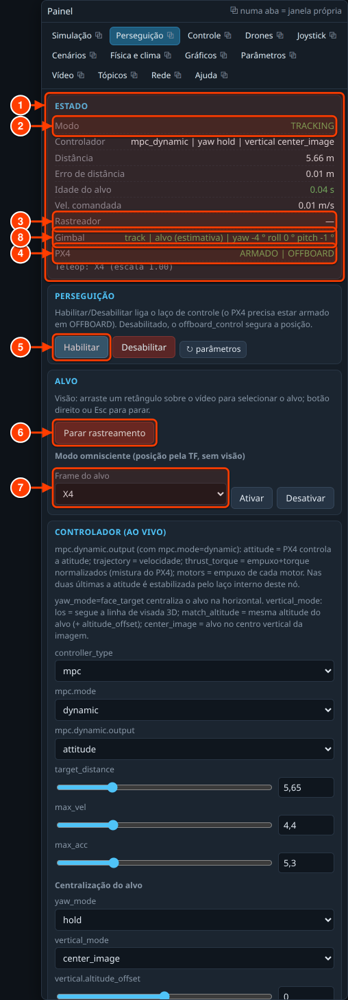

1. **Estado**: resumo do laço de perseguição.
2. **Modo** do supervisor (verde em TRACKING).
3. **Rastreador**: estado da caixa, *score* e profundidade.
4. **PX4**: armado e modo de navegação (precisa estar `ARMADO | OFFBOARD`).
5. **Habilitar / Desabilitar** o laço de controle (desabilitado: o `offboard_control` segura a posição).
   *↻ parâmetros* recarrega os controles depois que o container sobe.
6. **Parar rastreamento** (solta o alvo da visão).
7. **Modo omnisciente**: escolhe o frame do alvo (X4, X3, Tiltrotor...) e **Ativar** usa a TF exata do
   Gazebo no lugar da visão; **Desativar** volta à visão.
8. **Gimbal** (só com a câmera em gimbal): modo, para onde a câmera aponta (*alvo (estimativa)*,
   *alvo (linha de visada)*, *última direção*, *estabilizado*, *travado no corpo*) e os ângulos medidos
   de yaw, roll e pitch. Com câmera fixa mostra "— (câmera fixa)".

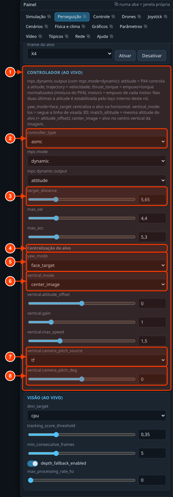

1. **Controlador (ao vivo)**: toda mudança vale na hora.
2. `controller_type` (mpc, ibvs_mpc, lqr, lqi, pbvs_pid, asmc, hermite, hybrid_pn, external); abaixo,
   `mpc.mode` e `output` (a lista só mostra as saídas que a lei ativa tem).
3. `target_distance` (distância de perseguição) e, abaixo, os limites `max_vel` e `max_acc`.
4. **Centralização do alvo** (ver §3).
5. `yaw_mode`: `face_target` aponta a câmera para o alvo (centraliza na horizontal).
6. `vertical_mode`: `los`, `match_altitude` ou `center_image` (centraliza na vertical).
7. `vertical.camera_pitch_source`: **`tf`** (padrão) lê a inclinação da câmera da TF estática da montagem;
   `param` usa o valor do item 8.
8. `vertical.camera_pitch_deg`: inclinação manual da câmera (para montagens inclinadas). **Só vale com
   `param`** (ou enquanto a TF não chegou).

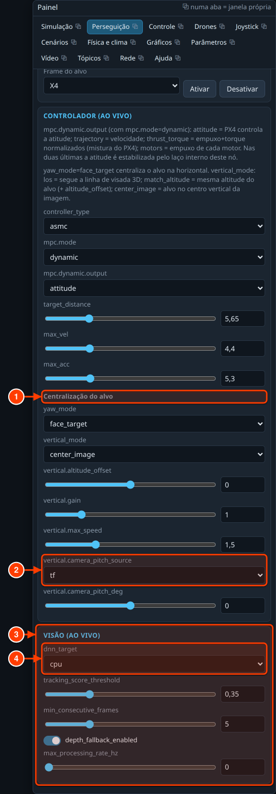

1. Centralização do alvo (continuação).
2. Fonte da inclinação da câmera (ver item 7 acima).
3. **Visão (ao vivo)**: limiar do rastreador, quadros de confirmação, fallback de profundidade e taxa.
4. `dnn_target`: inferência em `cpu`, `opencl` ou `opencl_fp16`, trocável em execução.

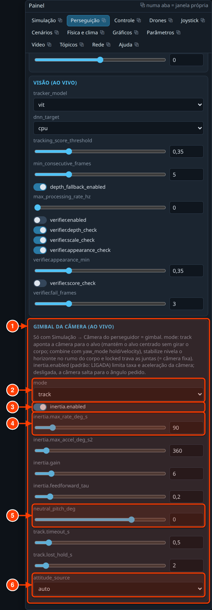

1. **Gimbal da câmera (ao vivo)** (só com Simulação → *Câmera do perseguidor* = gimbal; ver §3.0).
2. `mode`: `track` (o gimbal aponta para o alvo sozinho), `stabilize` (horizonte nivelado no rumo do
   corpo; quem centraliza é o corpo, como no IBVS-MPC com `camera_model: level`), `locked` (juntas
   travadas = câmera fixa) ou `mpc` (o gimbal segue `/gimbal/pointing_setpoint` do IBVS-MPC com
   `ibvs.gimbal_in_loop: true`; sem esse setpoint recente se comporta como `track`).
3. `inertia.enabled`: inércia do movimento da câmera, **ligada por padrão**. Desligada, a câmera salta
   para o ângulo pedido.
4. Limites da inércia: `inertia.max_rate_deg_s`, `inertia.max_accel_deg_s2`, `inertia.gain` e
   `inertia.feedforward_tau`.
5. `neutral_pitch_deg`: elevação de `locked`/`stabilize` e referência do `center_image` com gimbal.
   Abaixo, `track.timeout_s` e `track.lost_hold_s` (quanto tempo segura a última direção sem alvo).
6. `attitude_source`: `auto` usa a atitude verdadeira do Gazebo no modo omnisciente e a do EKF do PX4
   com visão.

### T8. Aba Controle (sintonia por método)

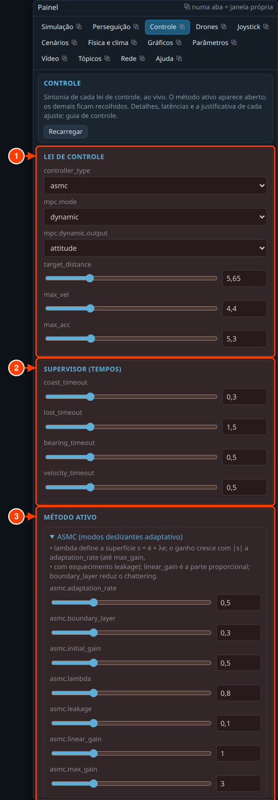

1. **Lei de controle**: tipo, modo do MPC, distância e limites (os mesmos da aba Perseguição).
2. **Supervisor (tempos)**: `coast_timeout`, `lost_timeout`, `bearing_timeout`, `velocity_timeout`.
3. **Método ativo**: os ganhos do controlador selecionado, aberto, com dicas de sintonia.

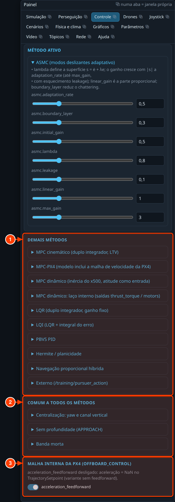

1. **Demais métodos**: os outros controladores, recolhidos (abra para ajustar antes de trocar).
2. **Comum a todos os métodos**: centralização (yaw e vertical), APPROACH e banda morta.
3. **Malha interna da PX4**: `acceleration_feedforward` do `offboard_control` (variante sem *feedforward*).

### T9. Aba Drones

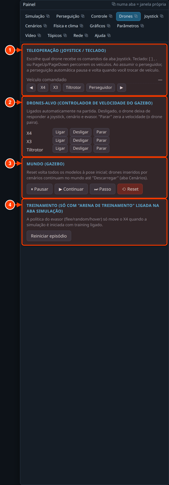

1. **Teleoperação**: qual veículo o joystick/teclado comanda (X4, X3, Tiltrotor, Perseguidor, ◀ ▶).
2. **Drones-alvo**: *Ligar/Desligar* o controlador de velocidade do Gazebo de cada drone; *Parar* paira.
3. **Mundo (Gazebo)**: pausar, continuar, um passo, reset.
4. **Treinamento**: reinicia o episódio (só com a arena de treinamento ligada).

### T10. Aba Joystick

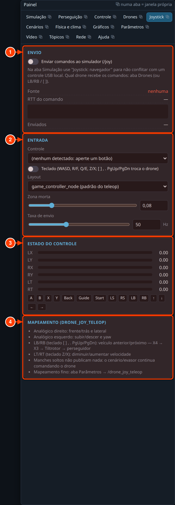

1. **Envio**: liga a publicação em `/joy` (sem isso nada chega ao simulador).
2. **Entrada**: gamepad detectado, **Teclado**, **Joystick virtual na tela** (toque; também pelo 🎮
   do cabeçalho), layout dos eixos, zona morta e taxa de envio.
3. **Estado do controle**: eixos e botões ao vivo (para conferir o mapeamento).
4. **Mapeamento**: o que cada eixo/botão faz no `drone_joy_teleop` (tabela em §2.4).

### T11. Aba Cenários

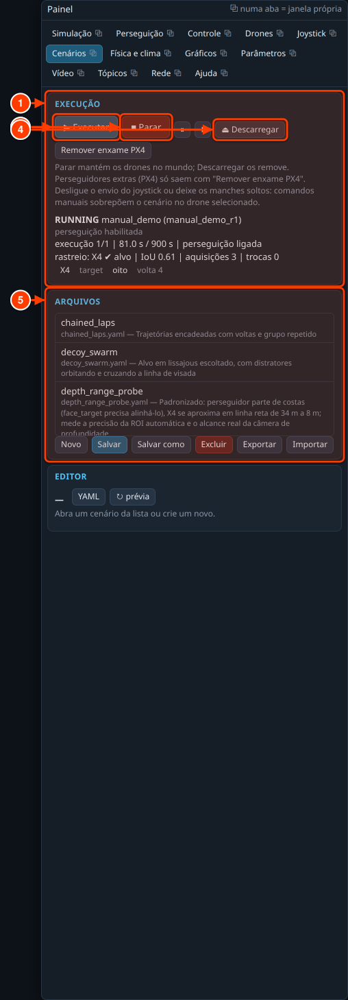

1. **Execução**: estado (`LOADED → STAGING → RUNNING → FINISHED`), tempo, engajamento e rastreio.
2. **▶ Executar**: salva, carrega e inicia o cenário aberto no editor.
3. **■ Parar**: drones pairam onde estão; ⏸/⏵ pausam e retomam.
4. **⏏ Descarregar**: remove do Gazebo os drones inseridos pelo cenário.
5. **Arquivos**: lista de `scenarios/*.yaml` (clique para abrir), **Novo**, **Salvar**, **Salvar como**, excluir,
   exportar e importar.

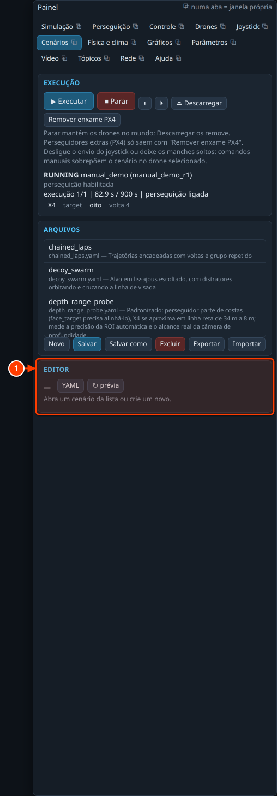

1. **Editor**: formulário (Scenario, Target com o caminho no mapa, Pursuer, Controller, Advanced) ou o texto
   **YAML**; *↻ prévia* desenha as trajetórias previstas na vista 3D e *✎ no 3D* edita waypoints com o
   mouse (detalhes em §2.5).

### T12. Aba Física e clima

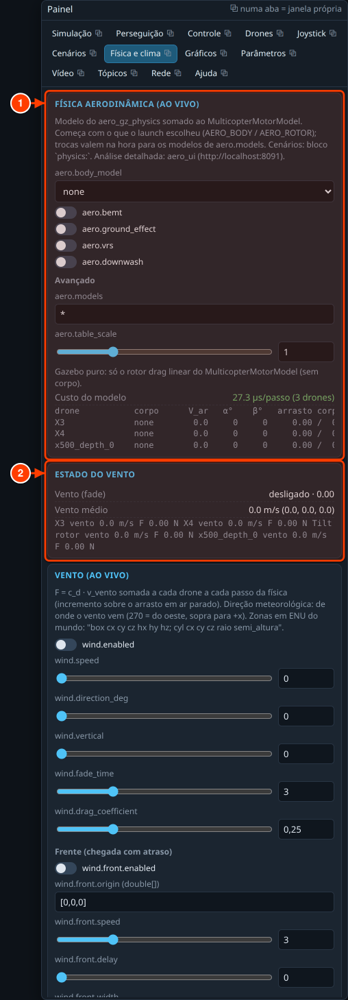

1. **Física aerodinâmica (ao vivo)**: modelo do corpo, BEMT, efeito solo, VRS, esteira e a tabela por
   drone (V do ar, α, β, arrasto, T/T_gz).
2. **Estado do vento**: liga/desliga, vento médio e força em cada drone.

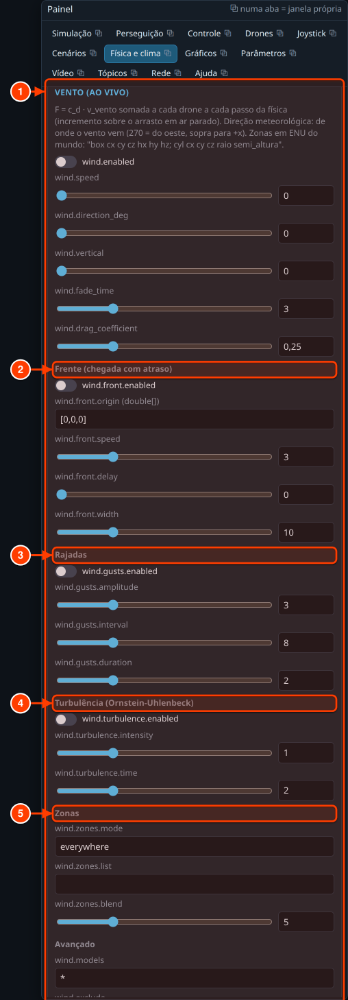

1. **Vento (ao vivo)**: velocidade, direção (de onde vem), componente vertical, coeficiente de arrasto.
2. **Frente**: chegada com atraso a partir de `front.origin`.
3. **Rajadas** (1−cos).
4. **Turbulência** (Ornstein-Uhlenbeck).
5. **Zonas** (`inside`/`outside`, caixas e cilindros).

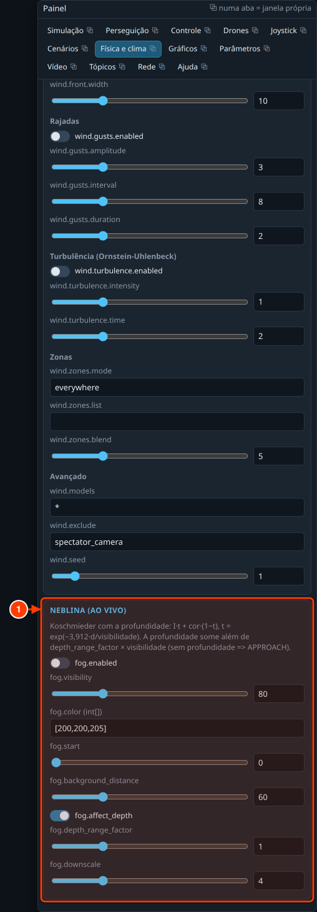

1. **Neblina (ao vivo)**: visibilidade, cor, distância sem neblina e efeito na profundidade (alvos além
   da visibilidade perdem a profundidade e caem em APPROACH).

### T13. Aba Gráficos

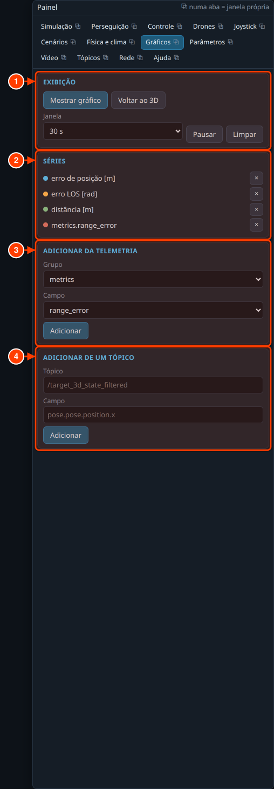

1. **Exibição**: *Mostrar gráfico* (troca a vista central), janela de tempo, pausar, limpar.
2. **Séries** em exibição (× remove).
3. **Adicionar da telemetria**: grupo (`metrics`, `status`, `detection`...) e campo.
4. **Adicionar de um tópico**: qualquer campo numérico de qualquer tópico (ex.: `/fmu/out/...`).

### T14. Aba Parâmetros

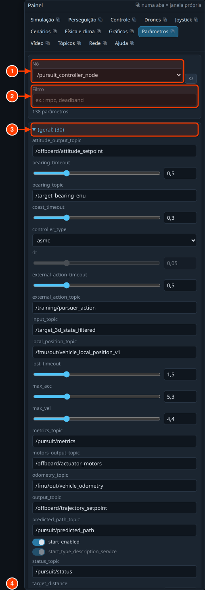

1. **Nó**: qualquer nó ROS em execução (padrão: `/pursuit_controller_node`).
2. **Filtro** por nome (ex.: `mpc`, `vertical`).
3. Grupos pelo prefixo do nome (`(geral)`, `asmc`, `mpc.dynamic`, ...).
4. Grupo **vertical**: parâmetros do canal vertical, inclusive a fonte da inclinação da câmera.

Passe o mouse sobre um parâmetro para ver a descrição (traduzida no modo EN).

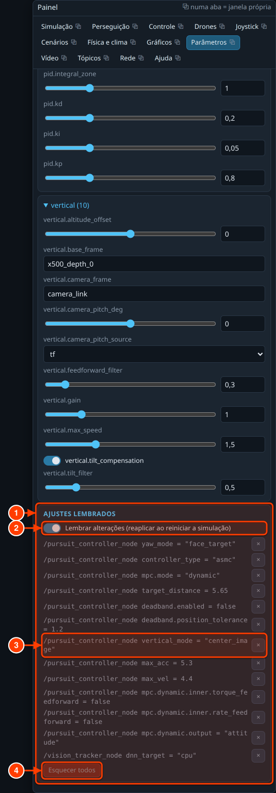

1. **Ajustes lembrados**: alterações feitas pela GCS que são **reaplicadas a cada nova partida**.
2. **Lembrar alterações**: liga/desliga essa memória.
3. Um ajuste lembrado (aqui `vertical_mode = "center_image"`). O **×** esquece só ele.
4. **Esquecer todos**.

> Se a simulação se comporta diferente do `aero_pursuit.yaml`, olhe aqui primeiro: um ajuste lembrado
> de uma sessão antiga é reaplicado sem aviso.

### T15. Abas Vídeo, Tópicos, Rede e Ajuda

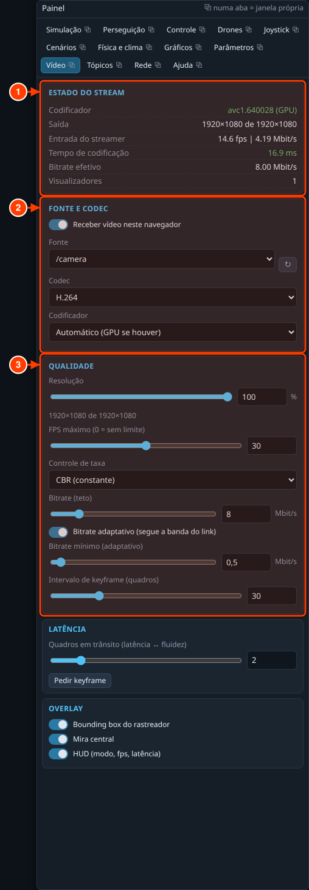

1. **Estado do stream**: codificador, saída, fps de entrada/saída, bitrate.
2. **Fonte e codec**: tópico (`/camera`, profundidade...), codec (H.264, H.265/HEVC, MJPEG) e codificador
   (automático, GPU ou CPU).
3. **Qualidade**: resolução, fps, bitrate, controle de taxa, modo adaptativo, GOP.

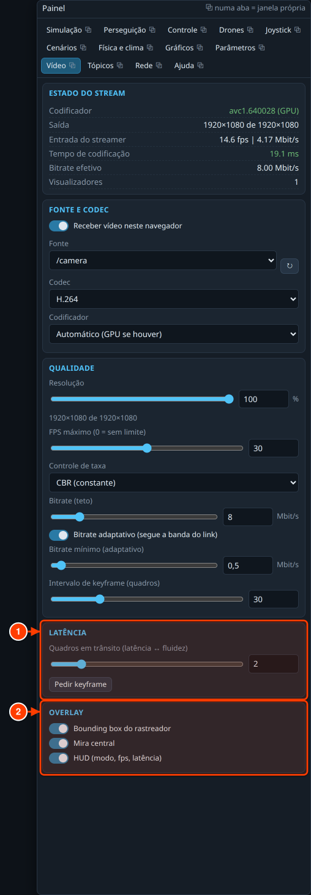

1. **Latência**: quadros em trânsito e *Pedir keyframe*.
2. **Overlay**: caixa do rastreador, mira central e HUD sobre o vídeo.

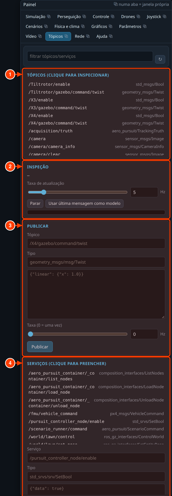

1. **Tópicos** (clique para inspecionar).
2. **Inspeção**: última mensagem em JSON do tópico escolhido.
3. **Publicar**: uma vez ou em taxa fixa (*Usar última mensagem como modelo*).
4. **Serviços**: clique para preencher e chamar.

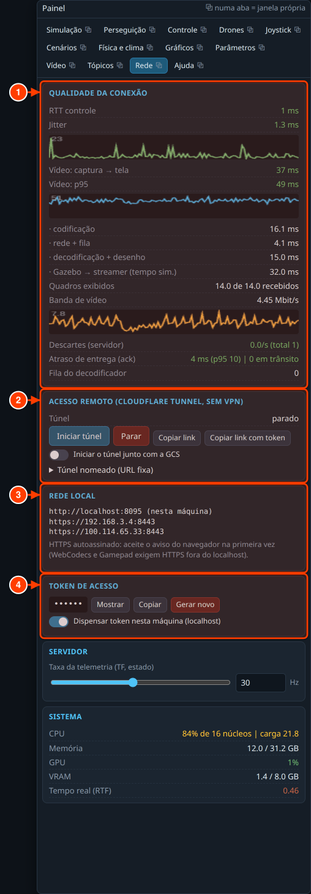

1. **Qualidade da conexão**: RTT, jitter e perdas ao longo do tempo.
2. **Acesso remoto** pelo Cloudflare Tunnel (rápido ou nomeado com URL fixa).
3. **Rede local**: endereços `http://` e `https://` desta máquina.
4. **Token de acesso** para acessar de outra máquina. Mais abaixo: **Servidor** (taxa da telemetria) e
   **Sistema** (CPU, memória, GPU, VRAM, RTF).

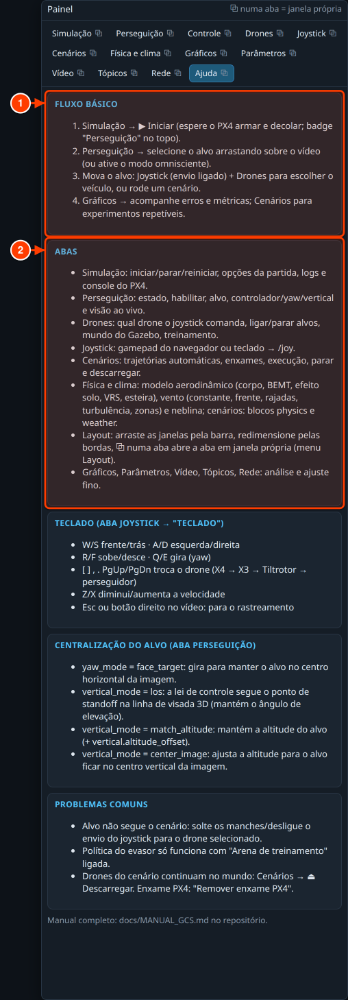

1. **Fluxo básico** e 2. **Abas**: resumo deste manual dentro da própria GCS.

---

## 0. Layout modular (janelas)

No modo **Livre** (padrão em telas ≥ 900 px), câmera, vista 3D/Gazebo/Gráficos e o painel de abas são
janelas: **arraste pela barra de título**, **redimensione pelas bordas e cantos** (encaixam numa grade
de 8 px e nas bordas das outras janelas). Janelas encostadas **dividem a borda**: aumentar uma
encolhe a vizinha e diminuir uma faz a vizinha ocupar o espaço (nunca sobrepõem nem deixam buraco; cada
janela para no tamanho mínimo). Puxar para dentro uma borda que está na borda da tela encolhe a janela
pelo lado oposto, e as vizinhas desse lado crescem. Ocultar ou fechar uma janela entrega a área dela às
vizinhas que a cobrem por inteiro de um lado. Janelas soltas (sem vizinha encostada) se comportam como
antes. **Duplo clique** maximiza/restaura e um clique traz para a
frente. O **⧉** ao lado do nome de qualquer aba abre a aba numa janela própria (ex.: Perseguição e
Física e clima lado a lado); **⇲** ou **×** devolvem ao painel. O menu **Layout ▾** (cabeçalho) troca
entre Livre e Clássico (o layout fixo antigo), aplica presets (*Padrão*, *Perseguição*, *Vídeo grande*,
*Análise*), mostra/oculta janelas e restaura o padrão. Posições, tamanhos e abas destacadas ficam salvos
no navegador (`localStorage`), em frações da tela.

---

## 1. Fluxo básico

1. **Simulação → ▶ Iniciar.** Espere o badge *Simulação* ficar verde e o PX4 decolar (aba
   Perseguição, linha *PX4*: `ARMADO | OFFBOARD`).
2. **Perseguição → selecione o alvo**: arraste um retângulo sobre o vídeo (visão) ou ative o
   **modo omnisciente** (posição exata pela TF, sem visão).
3. **Mova o alvo**: manualmente (abas **Joystick** + **Drones**) ou automaticamente (**Cenários**).
4. **Acompanhe** em **Gráficos** e no badge *Perseguição* (TRACKING / APPROACH / COASTING / LOST).

---

## 2. Abas (na ordem em que aparecem)

| Aba | Para que serve |
|---|---|
| **Simulação** | Iniciar / parar / reiniciar, opções da partida (agrupadas), compilar, processos, logs ao vivo e console do PX4 |
| **Perseguição** | Estado do supervisor e do rastreador, habilitar/desabilitar, seleção do alvo, modo omnisciente, controlador e centralização ao vivo, visão (inclusive `dnn_target` CPU/GPU em execução) |
| **Controle** | Sintonia de cada lei de controle separada por método (ativo aberto, demais recolhidos), com dicas; centralização, APPROACH e banda morta |
| **Drones** | Qual drone o joystick/teclado comanda, ligar/desligar/parar os drones-alvo, pausar/passo/reset do Gazebo, reinício de episódio do treinamento |
| **Joystick** | Gamepad do navegador ou teclado → `/joy` |
| **Cenários** | Caminho do alvo (mapa, formas, CSV/Excel), execução, parar, descarregar |
| **Física e clima** | Modelo aerodinâmico (corpo, BEMT, efeito solo, VRS, esteira) ao vivo, vento (constante, frente, rajadas, turbulência, zonas) e neblina na câmera |
| **Gráficos** | Séries da telemetria ou de qualquer campo numérico de tópico |
| **Parâmetros** | Qualquer parâmetro de qualquer nó, ao vivo |
| **Vídeo** | Fonte, codec, resolução, fps, bitrate do vídeo |
| **Tópicos** | Inspecionar/publicar tópicos e chamar serviços |
| **Rede** | Qualidade da conexão, túnel remoto, token |
| **Ajuda** | Referência rápida deste manual |

### 2.1 Simulação

- **▶ Iniciar / ■ Parar / ⟲ Reiniciar**: sobe/derruba Gazebo + PX4 + container ROS. *Reiniciar* espera
  os processos saírem antes de subir de novo.
- **Configuração** (salva sozinha, vale na próxima partida), em quatro grupos:
  - *Controle do perseguidor*: controlador, modo do MPC, **yaw**, **vertical** (ver §3) e **Câmera do
    perseguidor**: *fixa no corpo* (x500_depth, padrão) ou *gimbal de 3 eixos* (x500_gimbal_depth, §3.0).
    Trocar a câmera exige reiniciar a simulação (o modelo do Gazebo muda);
  - *Entrada e alvo*: origem do joystick, **arena de treinamento** e **política do evasor**;
  - *Percepção e gravação*: inferência, fonte das TFs, rosbag, streamer, Foxglove;
  - *Gazebo, PX4 e avançado*: mundo, headless, render, build do PX4, nível de log, gdb, args extras.
- **Logs**: escolha o arquivo e filtre por texto (ex.: `scenario_runner`, `WARN`).
- **Console do PX4**: comandos `commander ...`, `listener ...`.

> A **política do evasor** (flee/random/hover) **só move o X4 com "Arena de treinamento" ligada**.
> Sem ela, o X4 só se move pelo joystick ou por um cenário.

**Cenografia.** Aba Simulação → Cenário visual: `forest_sparse` ou `forest_edge` põem árvores
em volta da área de voo e ao fundo, nos dois simuladores (vale no próximo início). No Isaac Sim
custa RTF (0,90 e 0,85); ver [ISAAC_SIM.md](ISAAC_SIM.md#cenografia-árvores).

### 2.2 Perseguição

**Gimbal: comando manual.** Com a câmera em gimbal, a seção Gimbal tem um pad: arraste (ou use as
setas com o pad em foco) e a câmera gira com velocidade proporcional ao deslocamento, com o
horizonte nivelado (modo `manual`, ativado no primeiro movimento). **⌂ Posição padrão** volta para
a frente com a elevação neutra; **↩ Voltar a <modo>** restaura o modo anterior (por exemplo
`track`). Vale no Gazebo e no Isaac Sim.


- **Estado**: modo, controlador (`controlador | yaw | vertical`), distância e erro, idade da
  estimativa, velocidade comandada, rastreador, PX4 e veículo do teleop.
- **Habilitar / Desabilitar**: liga o laço de controle. Desabilitado, o `offboard_control` segura a
  posição. Ao assumir o perseguidor pelo joystick a perseguição pausa sozinha.
- **Alvo**: arraste sobre o vídeo; botão direito / Esc / *Parar rastreamento* para soltar.
  **Omnisciente**: escolhe X4/X3/Tiltrotor e usa a TF do Gazebo no lugar da visão.
- **Controlador (ao vivo)**, em três blocos: básico (lei, modo do MPC, distância, limites),
  **Centralização do alvo** (yaw e vertical, §3) e **Robustez** (aproximação sem profundidade,
  banda morta).
- **Visão (ao vivo)**: limiar do rastreador, quadros de confirmação, fallback de profundidade, taxa.
- **Gimbal da câmera (ao vivo)** (só com a câmera em gimbal): `mode` (`track`/`stabilize`/`locked`/`mpc`),
  `inertia.enabled` (**padrão: ligada**) e os limites de taxa/aceleração, `neutral_pitch_deg`,
  tempos de perda do alvo e `attitude_source`. Em *Estado*, a linha **Gimbal** mostra o modo, para onde
  a câmera aponta (alvo pela estimativa ou pela linha de visada, última direção, estabilizado, travado)
  e os ângulos medidos das juntas. Com câmera fixa ela mostra "— (câmera fixa)".

### 2.3 Drones

- **Teleoperação**: mostra o veículo comandado e tem um botão por veículo
  (`X4`, `X3`, `Tiltrotor`, `Perseguidor`) e ◀ ▶. Publica em `/drone_joy_teleop/select`.
- **Drones-alvo**: *Ligar/Desligar* o controlador de velocidade do Gazebo de cada drone; *Parar*
  zera a velocidade (paira).
- **Mundo**: pausar, continuar, um passo, reset (volta os modelos à pose inicial; drones inseridos por
  cenários não somem: use *Descarregar*).
- **Treinamento**: reinicia o episódio (só com a arena ligada).

### 2.4 Joystick

1. Ligue **Enviar comandos ao simulador**. Na aba Simulação deixe *Joystick: navegador* para não
   conflitar com um controle USB no servidor.
2. Gamepad: aperte um botão para o navegador detectá-lo. Teclado: ligue **Teclado** (isso já liga o
   envio). **Celular/tablet**: toque no **🎮** do cabeçalho (ou ligue *Joystick virtual na tela*): dois
   manches flutuam sobre qualquer aba e também ligam o envio.

| Tecla | Gamepad | Joystick virtual | Ação |
|---|---|---|---|
| W / S | analógico direito ↕ | manche direito ↕ | frente / trás |
| A / D | analógico direito ↔ | manche direito ↔ | esquerda / direita |
| R / F | analógico esquerdo ↕ | manche esquerdo ↕ | sobe / desce |
| Q / E | analógico esquerdo ↔ | manche esquerdo ↔ | gira (yaw) |
| `[` `]`, `,` `.`, PgUp / PgDn | LB / RB | ◀ / ▶ | veículo anterior / próximo: X4 → X3 → Tiltrotor → perseguidor |
| Z / X | LT / RT | vel − / vel + (segurar) | diminui / aumenta a escala de velocidade |

- **Joystick virtual**: arraste o polegar a partir do centro de cada manche (multitoque: os dois ao
  mesmo tempo); ao soltar ele volta ao centro e o comando zera. Entre ◀ e ▶ aparece o drone comandado.
  O **×** (ou o 🎮 de novo) fecha os manches. Só os manches e os botões capturam o toque: o vídeo e as
  abas atrás continuam utilizáveis. Pode ser combinado com gamepad e teclado (os valores se somam).

- As teclas são ignoradas com o foco num campo de texto ou na vista Gazebo (lá WASD move a câmera).
- `[` e `]` funcionam também no teclado ABNT2 (eles são lidos pelo caractere, não pela posição).
- **Com os manches soltos o teleop não publica nada**: ele envia um comando nulo ao soltar e depois
  fica quieto. Assim o joystick ligado não trava o drone do cenário nem o evasor. Enquanto você move os
  manches, o comando manual vence sobre o drone selecionado.

### 2.5 Cenários

A lista inclui as subpastas de `scenarios/` (por exemplo `tuning/`), e os cenários valem nos dois
simuladores.


Um cenário (`scenarios/*.yaml`) define drones, trajetórias e o perseguidor de forma reproduzível.
Referência comentada: [`scenarios/reference.yaml`](../scenarios/reference.yaml).

**Drones na simulação** (aba Drones): caixas X4, X3, Tiltrotor e X5; **Aplicar** remove do Gazebo os
desmarcados e reinsere os marcados que faltarem (serviço `/scenario_runner/set_drones`, lista
`base_drones` do `scenario_runner`). Drones usados pelo cenário carregado não são removidos. A escolha
fica salva no navegador. **X5** é o x500 da PX4 com controle de velocidade (mesma classe do perseguidor,
bom como alvo ou distrator). O **Tiltrotor** é o da PX4 completo, com a aerodinâmica (asa e
superfícies, `LiftDrag`) e os servos de inclinação mantidos em 0 (pairado); só o controlador de velocidade
foi acrescentado, sem duplicar os motores, e com os ganhos do X4 escalados pela massa e inércia (o
controlador os normaliza por elas). Degrau isolado: subida 0,97 m/s (1), frente 2,16 m/s (2), guinada 0,55 rad/s (0,6).

**Sintonia** (abas Perseguição e Controle): só os ajustes da técnica ativa, com nome, unidade, faixa,
efeito de aumentar/diminuir e ↺ para o padrão. A lista bruta fica em Controle → Avançado.

**Velocidade dos alvos**: `target_speed_scale` (campo do cenário e parâmetro ao vivo do
`scenario_runner`, slider em **Perseguição → Alvo**; o efetivo é o produto dos dois). Os drones do cenário
fazem os mesmos trajetos esse fator mais rápido (o relógio dos planos anda `s` vezes mais rápido e a
velocidade de referência é multiplicada por `s`; mudar em voo não causa saltos). Os modelos X3, X4 e
Tiltrotor aceleram até 3 m/s² e 10 m/s na horizontal (`MulticopterVelocityControl` nos `model.sdf`; o X4
tinha 1 m/s² e 5 m/s, o que o fazia ficar ~1,3 m atrás da referência no figure-8).

**Executar**

1. Abra um arquivo da lista (ex.: `figure8_basic.yaml`) ou clique **Novo**.
2. **▶ Run**: salva e roda. Com a simulação parada, ela é iniciada com o cenário.
3. O estado aparece abaixo dos botões: `LOADED → STAGING → RUNNING → FINISHED`, tempo, se a perseguição
   já engajou e o trecho atual de cada drone.

| Botão | Efeito |
|---|---|
| ▶ Executar | Salva, carrega (insere os drones que faltam) e inicia |
| ■ Parar | Interrompe: drones pairam onde estão, perseguição desligada; o cenário continua carregado |
| ⏸ / ⏵ | Pausa / retoma a execução |
| ⏏ Descarregar | Para e **remove do Gazebo todos os drones inseridos pelo cenário** (inclusive inserções ainda em andamento e drones que ficaram de execuções anteriores a um reset do mundo). X3/X4/Tiltrotor do mundo-base são preservados |

**Editar**

Every field has a one-line explanation under it; **? Help** explains everything (and shows
`scenarios/reference.yaml`).

- *Scenario*: name, repetitions, duration (or "until the path ends"), target speed ("as written in
  the path" or a fixed m/s), "end when the pursuer is within ... m".
- *Target*: drone name/model, start (📍 picks it on the map), nose (along the motion / hold / fixed),
  repeat the path, max speed, and the **path**: legs in order, as cards:
  - **✏ Path on the map**: a map window seen from above (grid in meters, pursuer and target starts,
    the rest of the path dashed) with the **height and speed over time** below it. Click = new point,
    click on a line = insert, drag = move, drag in the lower chart = height, Delete removes, Ctrl+Z
    undoes. Each point can have its own speed to the next one and a stop. Straight or smooth curve,
    closed loop.
  - **◯ Shape**: circle, polygon, figure 8, lissajous, helix, random loop, from their parameters
    (the center is dragged on the map); **Convert to points** makes it editable.
  - **📄 CSV / Excel**: a table (.csv, .tsv, .xlsx, or cells pasted from Excel) with x, y, z and,
    optionally, t. With t the target is at each point at its time (variable speed); without it, at
    constant speed. Column choice, time unit, fixed height, shift, "one row in N".
  - **→ Go to**, **⏸ Hover**, **⚡ Reactive** (flee, random walk, orbit the pursuer).
- *Pursuer*: start, "turn the camera to the target before starting" (or a start heading), detection
  (vision / omniscient), first box (automatic / manual), restart the tracker if lost, start the chase
  after N s (and optionally only once the tracker has the target), optional patrol before the chase.
- *Controller*: distance to keep and any other ROS parameter (JSON) applied at each run.
- *Advanced*: staging tolerances and the shared trajectories of YAML files.
- **YAML**: alterna para o texto bruto (comentários preservados ao salvar nesse modo).

**Simulações padronizadas.** Com `pursuer.face_target: true` (padrão) o estágio aponta a câmera para
a partida do alvo e **só termina com o rumo verdadeiro (ground truth) dentro de `yaw_tolerance_deg`**
(3°). Isso vale mesmo com o viés de rumo do EKF do PX4 (~7° no mundo `lawn`, pela declinação do campo
magnético): um integrador lento sobre o erro verdadeiro corrige o comando. Antes do engajamento, sem
patrulha, o perseguidor segura a posição e segue o alvo no yaw. A ROI automática (`acquisition: auto`)
projeta os **8 cantos da caixa visível orientada** de cada modelo (`target_acquisition.model_boxes`),
com as TFs **no instante do quadro**, em vez de uma esfera de raio fixo. Medido em
`depth_range_probe.yaml`: erro de rumo no estágio de 21,7° para 0,1°. O bloco `physics:` do cenário
(formulário: seção *Física aerodinâmica*) fixa o modelo aerodinâmico de cada execução.

### 2.5.1 Física e clima

- **Física aerodinâmica** (`/wind_node`, parâmetros `aero.*` → sistema `aero_gz_physics` no Gazebo):
  `aero.body_model` = `none` (Gazebo puro) | `linear` | `quadratic` | `panels` | `table` (recomendado),
  `aero.bemt`, `aero.ground_effect`, `aero.vrs`, `aero.downwash`; `aero.models` escolhe os modelos e
  `aero.table_scale` escala o arrasto do corpo. Os parâmetros começam iguais ao que a simulação usa (o
  launch escolhe com `AERO_BODY`/`AERO_ROTOR`) e cada mudança vale na hora. A tabela mostra, por drone, V
  do ar, α, β, arrasto do corpo × rotores e T/T_gz; a análise detalhada fica na `aero_ui`
  (`http://localhost:8091`). Nos cenários: bloco `physics:`.

- **Vento** (`/wind_node`): um sistema do Gazebo (`aero_wind`, carregado sozinho) soma a cada passo
  da física `F = c_d · v_vento(p)` em cada drone (incremento sobre o arrasto em ar parado). A direção é
  meteorológica: `direction_deg` é de onde o vento **vem** (270 = do oeste, sopra para +x). Modos
  combináveis: **frente** (chega a partir de `front.origin` a `front.speed`, depois de `front.delay`),
  **rajadas** (1−cos aleatórias ao longo do vento), **turbulência** (Ornstein-Uhlenbeck). **Zonas**
  `inside`/`outside` com caixas e cilindros (`box cx cy cz hx hy hz; cyl cx cy cz r hz`) e borda suave.
  `fade_time` liga e desliga gradualmente. O estado mostra o vento e a força em cada drone
  (`/weather/wind`).
- **Neblina** (`/fog_filter`): o Gazebo (ogre2) não tem fog; a neblina é aplicada na imagem com a
  profundidade (Koschmieder, `t = exp(−3,912·d/visibilidade)`). Todos os consumidores de `/camera`
  (rastreador, vídeo, gravação) veem a imagem com neblina. Com `affect_depth`, a profundidade some além
  da visibilidade, então alvos distantes caem em APPROACH.
- Nos cenários: bloco `weather:` (ver `scenarios/weather_front.yaml`). Os valores continuam aplicados
  depois da execução.

### 2.6 Gráficos, Parâmetros, Vídeo, Tópicos, Rede

- **Gráficos**: escolha séries da telemetria (erros, RMSE, esforço) ou qualquer campo numérico de um
  tópico; a vista *Gráficos* no painel central mostra as curvas.
- **Parâmetros**: lista de nós; mudanças valem na hora e podem ser lembradas e reaplicadas nas
  próximas partidas.
- **Vídeo**: fonte (`/camera`, `/camera/segmented_bb`, profundidade...), codec, GPU/CPU, resolução,
  fps, bitrate, modo adaptativo.
- **Tópicos**: inspecionar, publicar uma vez ou em taxa fixa, chamar serviços.
- **Rede**: RTT e perdas, túnel Cloudflare para acesso remoto, token.

---

## 3. Modos de controle: centralização do alvo

### 3.0 Câmera fixa ou gimbal

Na partida (Simulação → *Câmera do perseguidor*) escolhe-se a câmera **fixa no corpo** (padrão) ou o
**gimbal de 3 eixos**. Os dois modelos usam a mesma OakD-Lite: a profundidade acompanha a imagem para
onde a câmera olha.

- **Câmera fixa**: centralizar o alvo depende de mover o corpo inteiro (yaw e canal vertical, abaixo).
- **Gimbal**, `mode: track` (padrão): o gimbal mantém o alvo no centro da imagem e o perseguidor só
  precisa manter a distância. Use `yaw_mode: hold` ou `velocity` e `vertical_mode: los` ou
  `match_altitude` para não girar o corpo. `center_image` com gimbal usa como referência o eixo neutro
  do gimbal (`neutral_pitch_deg`, TF `gimbal_neutral`): mantém o alvo perto do meio do curso da junta de
  pitch. Nesse caso desligue `vertical.tilt_compensation`, porque o gimbal já estabiliza a arfagem.
- `mode: stabilize` nivela o horizonte no rumo do corpo; `mode: locked` trava as juntas e reproduz a
  câmera fixa no modelo com gimbal (útil para comparar os dois no mesmo voo).
- **Inércia** (`inertia.enabled`, **padrão: ligada**): a câmera gira com taxa e aceleração limitadas
  (90°/s, 360°/s²) e sem sobressinal. Desligada, ela salta para o ângulo pedido. A estabilização contra
  a rotação do corpo vale nos dois casos.

Tudo isso é trocável ao vivo na aba Perseguição → *Gimbal da câmera* ou com
`ros2 param set /gimbal_controller mode stabilize` / `... inertia.enabled false`.

### 3.0.1 Canais de centralização

Com a câmera fixa (ou o gimbal em `locked`), centralizar o alvo na imagem envolve dois canais:

| Canal | Parâmetro | Modos |
|---|---|---|
| Horizontal | `yaw_mode` | `face_target` (**centraliza na horizontal**: o nariz/câmera aponta para o alvo), `hold`, `velocity`, `fixed` |
| Vertical | `vertical_mode` | `los`, `match_altitude`, `center_image` |

**`vertical_mode`**

- `los` (padrão, comportamento anterior): a lei de controle persegue o ponto a `target_distance`
  metros antes do alvo **ao longo da linha de visada 3D**. Ela mantém o ângulo de elevação que existia
  e **não** iguala a altitude: um alvo 3 m acima continua acima.
- `match_altitude`: o canal z passa a ser `v_z = v_alvo,z + k·(z_alvo − z + offset)`. O perseguidor
  fica na **mesma altitude do alvo** (`vertical.altitude_offset` > 0 o põe acima). O plano horizontal
  continua com a lei escolhida.
- `center_image`: escolhe a altitude que põe o alvo no **centro vertical da imagem**. Considera a
  inclinação da câmera no corpo e, com `vertical.tilt_compensation`, a arfagem medida do drone
  (filtrada por `vertical.tilt_filter`). Com câmera horizontal e drone nivelado equivale a
  `match_altitude`.
  - **Inclinação da câmera**: com `vertical.camera_pitch_source: tf` (padrão) ela é lida da TF estática
    `vertical.base_frame → vertical.camera_frame` (`x500_depth_0 → camera_link`, 0° no x500_depth). Com
    `param`, ou enquanto a TF não chega, vale `vertical.camera_pitch_deg`. Se os dois discordam em mais
    de 2°, o log avisa que o parâmetro foi ignorado.
  - Por que importa: o controle mira o alvo **no eixo óptico configurado**. Um `camera_pitch_deg` de −31°
    numa câmera nivelada fazia o perseguidor subir até ver o alvo 31° abaixo do centro e só manter a
    distância (medido no SITL: elevação média −30°; com a TF, RMS de 5,6° na vertical e 2,4° na
    horizontal no oito de `scenarios/tuning/s3_figure8.yaml`).

Ajustes: `vertical.gain` [1/s], `vertical.max_speed` [m/s]. Os modos `match_altitude` e
`center_image` substituem só o canal z do comando, então valem para qualquer `controller_type`.
Exceção: `mpc.mode: dynamic` com saída de atitude (o empuxo é comandado direto). Nesse caso o modo é
ignorado e um aviso aparece no log. Na aproximação sem profundidade (APPROACH) vale
`fallback.vertical_gain`.

Como trocar:

- **Ao vivo**: aba Perseguição → *Centralização do alvo*; ou
  `ros2 param set /pursuit_controller_node vertical_mode match_altitude`.
- **Na partida**: aba Simulação → *Vertical*; ou `vertical_mode:=center_image` no launch.
- **Num cenário**: `parameters: {/pursuit_controller_node: {vertical_mode: center_image}}`.

### 3.1 Saída para o PX4 (`output`)

O que vai ao PX4 é escolhido em **Perseguição → Controlador** / **Controle** (ao vivo) ou
**Simulação → Saída para a PX4** (na partida). A lista só mostra o que a lei/modelo aceita, e trocar
para uma lei sem a saída escolhida ajusta o parâmetro para a saída padrão dela.

**Estrutura das técnicas MPC (o que comparar no TCC)**

| Técnica | Modelo de predição | `mpc.lag` modela | Saídas | Yaw | Altitude |
|---|---|---|---|---|---|
| `mpc` cinemático (LTV) | duplo integrador (+ `[p, v, v_ref]` com lag) | malha de velocidade, τ = `mpc.lag.tau` | trajectory, attitude, thrust_torque, motors | `yaw_mode` (P de ângulo da PX4/laço interno) | `vertical_mode` em malha separada sobre o z do comando (`los`: o próprio MPC) |
| `mpc` dinâmico | posição + atitude do x500 (inércia) | malha de atitude (`mpc.dynamic.attitude_model`); sem lag = atitude ideal | attitude, thrust_torque, motors | `yaw_mode` | `vertical_mode` vira a **referência de altitude dentro do MPC** (o empuxo é entrada dele) |
| `ibvs_mpc` | duplo integrador + yaw (1ª ordem + atraso) + câmera; lag como no cinemático | malha de velocidade, τ = `mpc.lag.tau` | trajectory, attitude, thrust_torque, motors | **dentro do MPC** (taxa planejada; ~96% do comando) | **dentro do MPC** (alvo na imagem no custo) |

Sem lag, cada modelo assume que a malha interna executa o comando na hora; com lag, ela entra no
modelo e o resto do problema (custo, restrições, predição do alvo) não muda, então ligar/desligar
compara só o modelo. O MPC dinâmico não tem `trajectory`: o modelo dele já contém a dinâmica de
atitude, e a malha de velocidade da PX4 ficaria entre o modelo e a planta.

| Saída | O que é enviado | Quem estabiliza a atitude |
|---|---|---|
| `trajectory` (padrão) | TrajectorySetpoint (velocidade + aceleração) | PX4 (todos os laços) |
| `attitude` | VehicleAttitudeSetpoint (atitude + empuxo) | PX4 (laços de atitude e taxa) |
| `thrust_torque` | VehicleThrustSetpoint + VehicleTorqueSetpoint normalizados (Offboard `thrust_and_torque`) | **laço interno deste nó**; a mistura nos motores é do PX4 |
| `motors` | ActuatorMotors: comando de cada motor (Offboard `direct_actuator`) | **laço interno deste nó** e alocação própria |

**Modelos cinemáticos** (`mpc.mode: kinematic`, com ou sem lag, e `ibvs_mpc`): a lei produz velocidade
e aceleração. Com uma saída direta, a malha de velocidade da PX4 sai do caminho e entra a deste nó
(**Controle → Malha de velocidade própria**, `velocity_loop.*`): `a = a_ff + Kp·e_v + ∫Ki·e_v`, com
limite de inclinação e de empuxo e anti-windup, a cada odometria; o vetor de empuxo vira atitude por
planicidade (yaw da lei ou da política de yaw). Os ganhos padrão são os da PX4. Com `mpc.lag` ligado,
`mpc.lag.tau` passa a representar o atraso desta malha (`mpc.lag.adaptive` o identifica em voo).
No **MPC dinâmico** a atitude e o empuxo vêm do próprio MPC.

Em `thrust_torque` e `motors` o PX4 não estabiliza a atitude. Os feedforwards de taxa e de aceleração angular do
MPC vêm **desligados**: a atitude desejada muda a 20 Hz e as taxas previstas a contradizem dentro do
passo, o que fez o laço divergir no Gazebo. O teste `DynamicMpcInnerLoop.RateFeedforwardDiverges`
reproduz isso. O aborto considera só o erro de **inclinação**: um erro de guinada grande (alvo passou
por cima) apenas gira o drone. Um laço em SO(3) roda a cada odometria (~100 Hz)
sobre a última referência do MPC (atitude, taxas e aceleração angular previstas). A alocação usa o
modelo físico do Gazebo (T = kf ω², torque de reação km·T, geometria dos rotores). Em `thrust_torque`
ela é convertida para os valores normalizados que o alocador do PX4 transforma de volta exatamente nos
mesmos comandos de motor. Ajustes em *MPC dinâmico: laço interno*: banda de rolagem/arfagem e de
guinada, amortecimento, feedforward e erro máximo.

**Segurança**: com erro de atitude acima de `max_attitude_error_deg` (60°), sem odometria ou sem
referência recente, o nó para de publicar. Após 0,25 s o `offboard_control` volta a segurar posição
com os controladores do PX4.

### 3.1.1 Atraso da malha de velocidade (`mpc.lag`) e variante sem *feedforward*

- `mpc.lag.enabled` (caixa na aba Perseguição, com `mpc.mode: kinematic`): o **mesmo** MPC LTV passa a
  prever a velocidade medida atrás da referência, `v' = (v_ref − v)/τ` (estado `[p, v, v_ref]`,
  discretização exata). Restrições, LOS prevista e predição do alvo não mudam: ligar/desligar compara só
  o modelo. `mpc.lag.tau` (cursor ou valor digitado, 0,02–1,5 s), `mpc.lag.adaptive` (RLS em voo).
  No teste de aproximação com τ = 0,4 s o sobressinal cai à metade; contra alvo em curva, com os mesmos
  pesos, o modelo com lag é menos agressivo. Substitui o antigo `kinematic_lag` (MPC-PX4), que era outro
  MPC (ganho fixo, sem restrições nem predição do alvo); estudos antigos foram migrados.
- `offboard_control.acceleration_feedforward: false`: o `TrajectorySetpoint` vai com aceleração NaN e o
  PX4 fecha só o PID de velocidade (variante "sem feedforward" da opção A). Chave na aba Controle,
  seção *Malha interna da PX4*; trocável em voo.
- τ identificado no SITL (`ros2_ws/identify_px4_lag.py <sessões>`): com feedforward ≈ 0,20 s
  (tempo morto ≈ 20 ms); sem feedforward ≈ 0,35–0,43 s + tempo morto ≈ 0,26–0,36 s.

### 3.2 Sem profundidade (APPROACH)

Quando o rastreador vê o alvo mas a câmera de profundidade não dá a distância, o supervisor entra em
**APPROACH** e segue a linha de visada. A distância passa a ser a **última medida 3D (até
`fallback.range_memory` s), extrapolada**, e a aproximação **para** a `target_distance +
fallback.stop_margin`. Mais perto que isso, **recua**. Sem medida recente, a distância vem do tamanho
da ROI: o tamanho do alvo é aprendido enquanto há profundidade (`fallback.learn_size`; antes disso vale `fallback.target_size`, 0,45 m) e a expansão da ROI (tempo até o contato) modula a
velocidade. Com `target_size: 0` só resta o tempo até o contato, que **não para** o drone: ele avança
até encostar no alvo. O painel mostra "~X m (última medida; sem
profundidade)" ou "desconhecida". Em LOST a distância aparece como "— (alvo perdido)", em vez do último
valor congelado.

**Alcance da câmera de profundidade.** O OakD-Lite simulado mede de **0,2 a 19,1 m** (clip do
StereoOV7251 no SDF do PX4). Medido no Gazebo (`probe_acquisition.py`, X4 se aproximando de 34 a 8 m):
profundidade válida até ~19 m, transição entre 18 e 20 m e, além disso, todos os pixels vêm **+inf**.
Com ≥ 85 % da ROI além do alcance (`depth_beyond_fraction`), o rastreador publica
`range_lower_bound = depth_max_range` na linha de visada e `depth_beyond_range` na detecção: o APPROACH
nunca usa uma estimativa menor que 19,1 m (o alvo está **mais longe que isso**), em vez de supor que
está perto.

---

## 5. Instalação e o comando `aero`

O mesmo `./aero` em todo computador que roda uma GCS, em modo nativo (ROS no host) ou docker
(imagem `aero-pursuit`, sem ROS no host).

```bash
./aero install        # uma vez: GCS + "Aero GCS" no menu + ~/.local/bin/aero + início automático
aero view             # abre esta GCS (sobe se ela não estiver no ar)
aero status           # modo, GCS, início automático, simuladores e simulação
aero sim start|stop|status   # com o formulário salvo na aba Simulação
aero sim gazebo|isaac # troca o simulador desta GCS (ela reinicia)
aero study <arquivos> # estudos em cascata (§6)
aero access           # links e token desta GCS e do túnel
aero gcs restart      # reinicia a GCS (depois de mudar o código dela)
aero update           # git pull + reinício
```

Referência completa, com o lançador do computador de acesso: [COMANDOS.md](COMANDOS.md).
O serviço fica ocioso até alguém abrir a GCS; as simulações e os estudos continuam rodando com o
navegador fechado.

---

## 6. Estudos em lote e em cascata

Um **estudo** (`scenarios/studies/*.yaml`) roda cada cenário com cada variante, `repetitions` vezes,
e resume as métricas em `datasets/studies/<nome>_<data>/summary.csv`:

```yaml
name: meu_estudo
repetitions: 3
scenarios: [../tuning/s3_figure8.yaml, ../tuning/s4_zigzag.yaml]
variants:
  - {name: mpc, parameters: {/pursuit_controller_node: {controller_type: mpc}}}
  - {name: ibvs, parameters: {/pursuit_controller_node: {controller_type: ibvs_mpc}}}
```

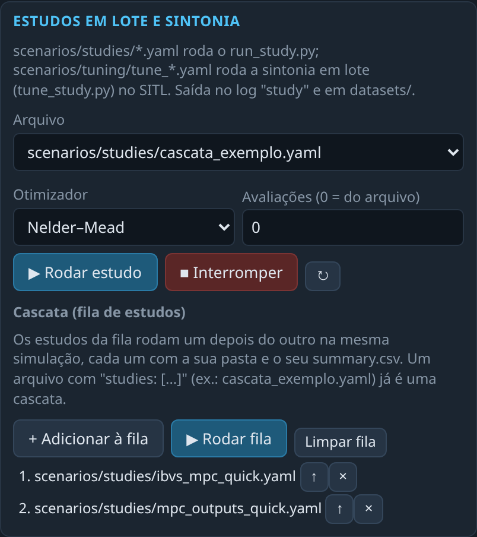

Uma **cascata** roda vários estudos um depois do outro, na mesma simulação (sem reiniciá-la). Cada estudo continua com a sua pasta e o seu `summary.csv`. Três
formas de montar:

1. **Pela GCS**: aba Simulação → *Estudos em lote e sintonia*, escolha o arquivo e clique
   **+ Adicionar à fila**; repita, ordene com ↑, remova com ×, e **▶ Rodar fila**. A fila fica
   salva no navegador. O andamento aparece no log `study`; **■ Interromper** encerra o estudo atual
   e grava o resumo do que já rodou.
2. **Por um arquivo de cascata** (vale como um estudo comum, inclusive na GCS):
   ```yaml
   # scenarios/studies/cascata_exemplo.yaml
   name: cascata_exemplo
   studies: [ibvs_mpc_quick.yaml, mpc_outputs_quick.yaml]   # relativos a este arquivo
   ```
3. **Pelo terminal**: `aero study a.yaml b.yaml c.yaml [--repetitions N] [--dry-run]`
   (`--dry-run` só gera os cenários combinados, para conferir).

A **sintonia** (`scenarios/tuning/tune_*.yaml`, Nelder–Mead ou bayesiana) roda sozinha, fora da
cascata. No Isaac Sim os estudos usam a simulação já aberta (`--external-sim`): inicie-a antes.

Cada execução vira uma sessão em `datasets/` com `session_info.yaml` (métricas) e `replay.yaml`
(ambiente e parâmetros no início, §7).

---

## 7. Replay de sessão

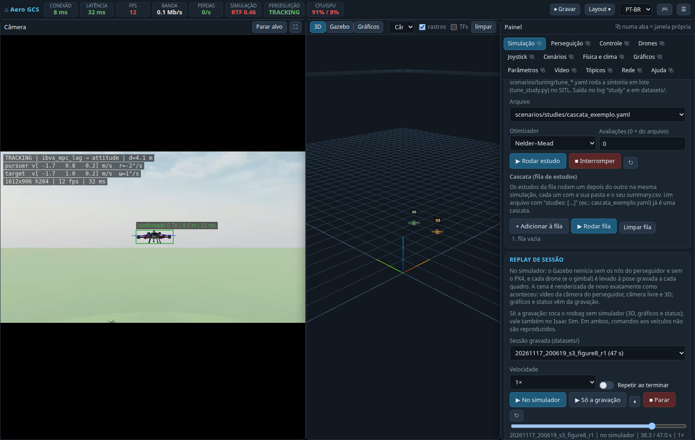

Aba Simulação → **Replay de sessão**. Escolha a sessão (`datasets/`), a velocidade (0,25–4×) e se
repete ao terminar. Os dois modos tocam o rosbag gravado pelo `session_recorder`; pausa (⏸) e
busca na barra valem para os dois.

**▶ No simulador** (Gazebo): reconstrói o que aconteceu dentro do simulador.

1. O Gazebo reinicia no modo replay: sem os nós do perseguidor, sem gravação, sem gravidade e com
   o PX4 desligado depois de subir (o modelo do x500 continua no mundo). Mundo, câmera (fixa ou
   gimbal) e cenografia vêm do `replay.yaml` da sessão; os drones do cenário são inseridos a partir
   do texto do cenário guardado no bag.
2. O nó `world_replay` recebe as poses gravadas (`/tf` do bag, remapeado para `/replay/tf`) e
   teleporta todos os modelos de uma vez a cada quadro (`/world/<mundo>/set_pose_vector`); os ângulos
   gravados do gimbal vão para as juntas.
3. O Gazebo renderiza a cena de novo: vídeo da câmera do perseguidor, câmera livre e vista 3D ao
   vivo. HUD, caixa do rastreador, gráficos e status vêm da gravação.

É exato por construção: as poses são as que aconteceram, a menos de centímetros de atraso entre o
bag e o teleporte. Rodar a sessão de novo pela dinâmica não serviria para isso: os nós ROS não andam
no passo da física, e uma nova execução se afasta da original (medido em 17/11: até ~6 m no meio do
oito). **■ Parar** encerra o replay e o simulador dele.

**▶ Só a gravação**: toca o rosbag sem simulador (`--clock` + `gcs_telemetry` avulso): 3D, gráficos
e status. É o modo do Isaac Sim (lá o perseguidor do Pegasus não aceita teleporte) e o mais leve.
Só há vídeo se `/camera` foi gravado (`session_recorder.extra_topics`).

Em nenhum dos dois os comandos aos veículos (`/fmu/in`, `/offboard`, joystick) são reproduzidos.
Cada sessão também guarda, para referência, o `replay.yaml` (ambiente e todos os parâmetros dos nós
no início) e as ações do operador pela GCS (`/gcs/input_log`).

---

## 8. Perseguidor remoto (Raspberry Pi)

Aba Simulação → *Perseguidor* → **Execução do perseguidor: remoto**, com o host `usuário@IP`
(vazio: `AERO_PI_HOST` ou a Pi padrão). Ao **Iniciar**, a GCS sobe o simulador sem os nós do
perseguidor (imagens em JPEG/PNG para a rede) e depois o contêiner `aero-pursuer` na Pi, com o
controlador, a saída, o yaw, a vertical, a inferência, o mundo e a câmera do formulário. **Parar**
derruba a Pi antes do simulador.

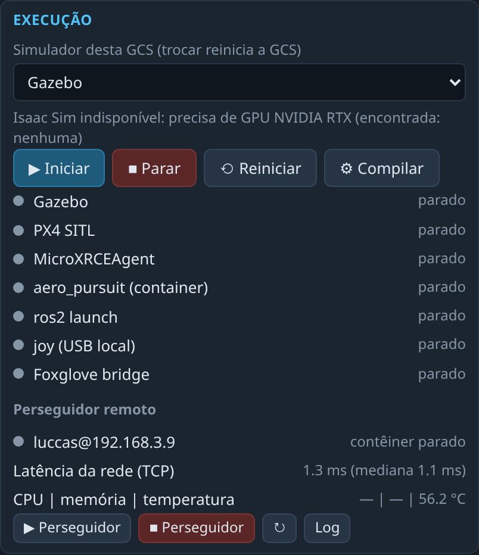

Em *Execução*, o quadro **Perseguidor remoto** mostra a cada 5 s: contêiner rodando ou parado,
latência da rede, CPU, memória e temperatura da placa. Os botões sobem ou param só a Pi, e **Log**
abre o `docker logs` dela. **Parar a simulação se a latência passar de** (ms) desliga tudo após três
leituras seguidas acima do limite (0 = nunca). Só no Gazebo por enquanto. Preparação da placa e
resultados: [RASPBERRY.md](RASPBERRY.md).

---

## 9. Gazebo ou Isaac Sim

Aba Simulação → **Simulador desta GCS**. Trocar reinicia a GCS (a página recarrega sozinha) e só é
aceito com a simulação parada. O Isaac só aparece habilitado num computador com GPU NVIDIA RTX e o
Isaac instalado (`aero isaac setup`, `aero isaac build`); sem isso, a lista mostra o motivo (num
computador sem NVIDIA fica só o Gazebo).

O que muda no Isaac: um perseguidor, sem vento nem plugin aerodinâmico, campos do Gazebo escondidos,
ambiente do Isaac selecionável. Ver [ISAAC_SIM.md](ISAAC_SIM.md#gcs).

---

## 10. Problemas comuns

| Sintoma | Causa / solução |
|---|---|
| O alvo do cenário não sai do lugar / "Estágio incompleto após 45 s" | O joystick estava publicando comando zero o tempo todo no X4. Corrigido: manches soltos não publicam mais. Se ainda acontecer, desligue o envio na aba Joystick e confira em Drones se o alvo está *Ligado* |
| Política do evasor não faz nada | Só funciona com *Arena de treinamento* ligada (aba Simulação) |
| Não consigo trocar de drone pelo teclado | Ligue *Teclado* na aba Joystick (isso já liga o envio) e use `[` `]`, `,` `.` ou PgUp/PgDn com o foco fora de campos de texto e da vista Gazebo. Ou clique no drone na aba Drones |
| Drones do cenário continuam no mundo | Cenários → ⏏ Descarregar |
| "o cenário usa N perseguidores extras..." | Aceite o reinício proposto pela GCS |
| Ao trocar omnisciente → visão a distância vira "—" e o drone avança sem controlar a distância | Era a profundidade nunca pareada com a imagem (câmeras sem sincronismo): corrigido com pareamento pelo carimbo mais próximo (`depth_buffer_size`). Se faltar profundidade, APPROACH agora para/recua pela última distância conhecida |
| Rastreador nunca confirma o alvo (score ~0,3), log cheio de `OpenCL error CL_INVALID_WORK_GROUP_SIZE` | A inferência OpenCL do TrackerVit falha nesta GPU/driver. Use **Simulação → Inferência: cpu** (testado: 100% dos quadros confirmados e com profundidade) |
| `thrust_torque`/`motors` oscilando | Mantenha `rate_feedforward` e `torque_feedforward` desligados (padrão); reduza `roll_pitch_bandwidth` |
| Parâmetro "não aparece" na aba Perseguição | Clique *↻ parâmetros* depois que o container subir |
| `center_image` não centraliza: o perseguidor fica acima/abaixo do alvo e só mantém a distância | Inclinação da câmera errada. Use `vertical.camera_pitch_source: tf` (padrão) ou corrija `vertical.camera_pitch_deg`; confira em Parâmetros → *Ajustes lembrados* se um valor antigo está sendo reaplicado |
| `center_image` não muda nada | Ele não vale em APPROACH (sem profundidade: vale `fallback.vertical_gain`) nem com `mpc.mode: dynamic` + saída de atitude |
| Eixos, grade ou linhas piscando na vista 3D | Corrigido: linhas dinâmicas com buffer fixo (antes vazavam ~34 buffers de GPU/s), grade sem escrita de profundidade, eixos das TFs com ordem de desenho fixa. Recarregue a página (Ctrl+Shift+R) para pegar o JS novo |
| Replay no simulador sem os drones do cenário | Sessões gravadas antes de 17/11/2026 não têm o texto do cenário no bag: só os drones do mundo base (X3, X4, X5, Tiltrotor) e o perseguidor aparecem |
| Replay no simulador lento (RTF baixo) | A renderização da câmera domina; as poses seguem o relógio do bag, então a cena continua correta, só com menos quadros |
| Perseguidor remoto "inacessível" | Pi desligada, IP errado ou sem chave SSH; teste `ssh <host> true`. Com a Pi fora, o PX4 entra em failsafe |
| Isaac desabilitado no seletor de simulador | Este computador não tem GPU RTX, o Isaac não está instalado (`aero isaac setup`) ou, no modo docker, o agente do host parou (`aero gcs restart`) |
| Textos em português com o idioma EN | Recarregue a página; textos novos precisam de entrada em `web/js/i18n.js` (textos desenhados em canvas usam `t()`). As descrições dos cenários vêm dos próprios YAML e não são traduzidas |
