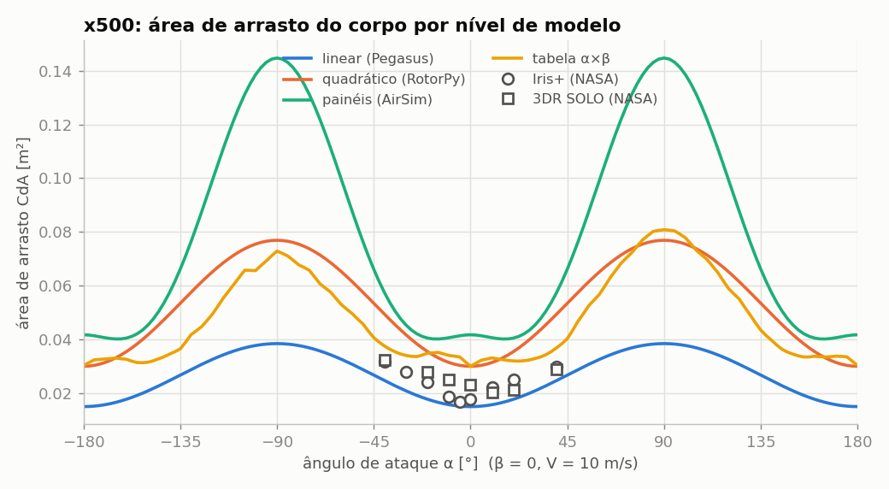
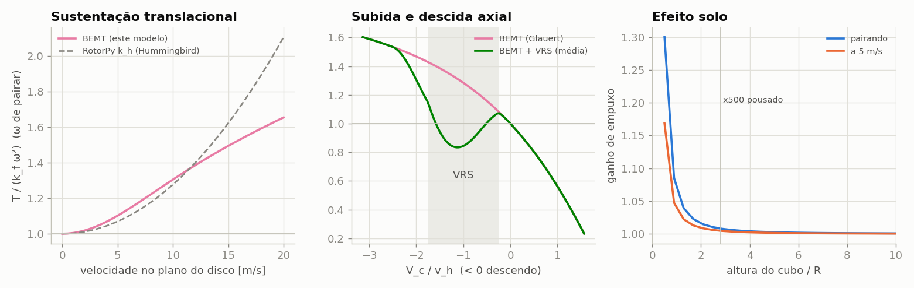
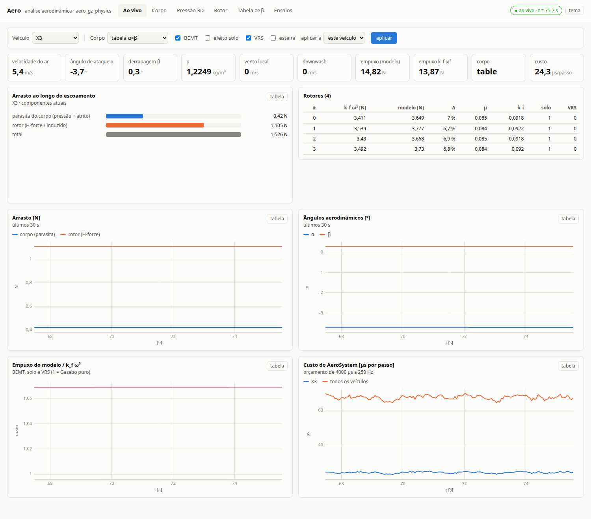
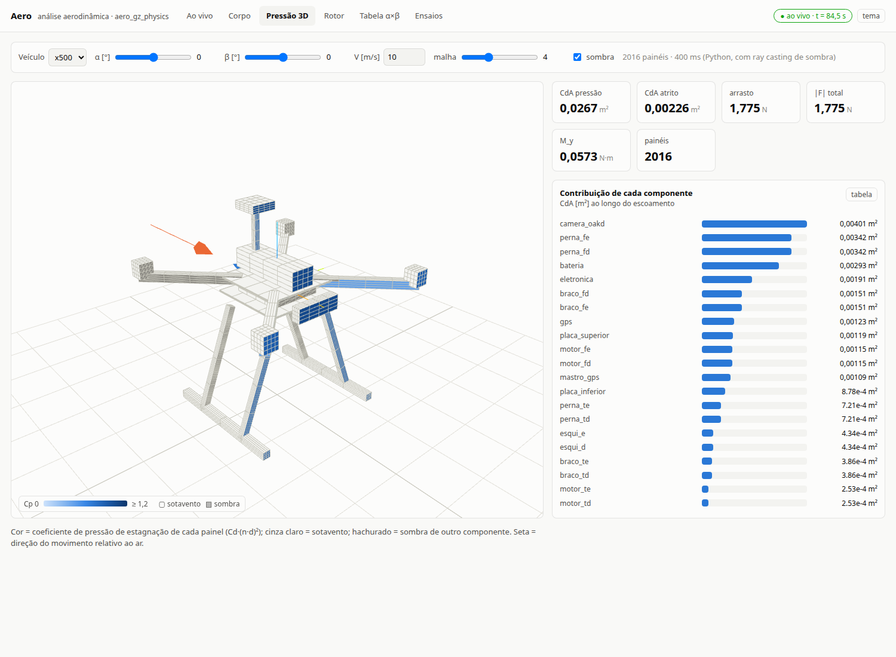
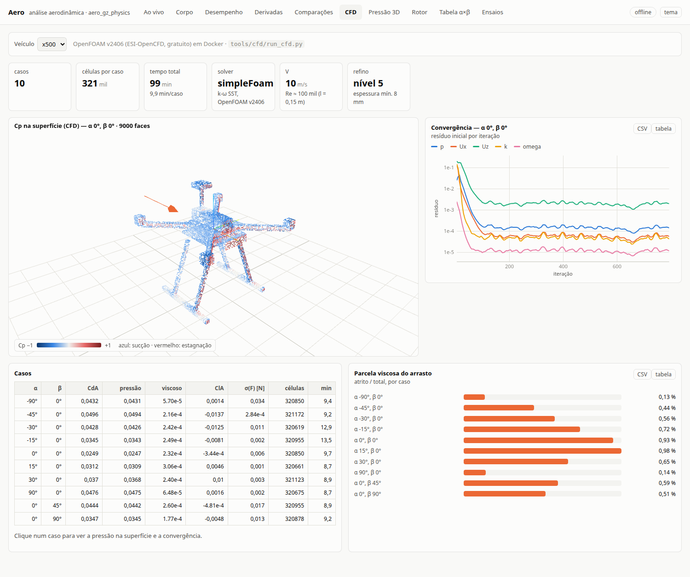
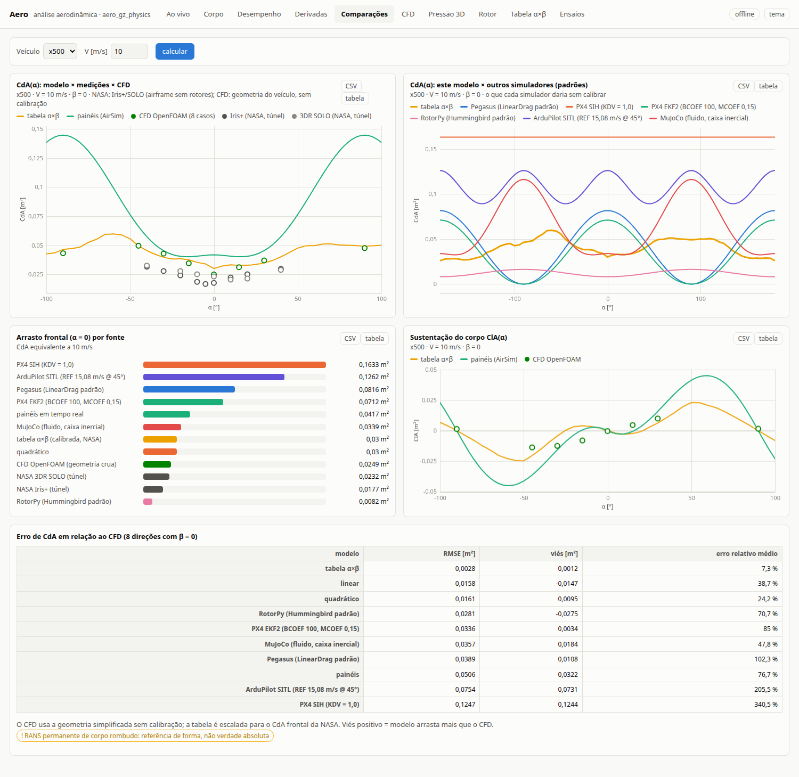

# 7. Implementação e resultados (aero_gz_physics)

Implementado em 2026-11-05, branch `feat/aero-physics`. Pacote `ros2_ws/src/aero_gz_physics`
(núcleo C++ sem Gazebo + plugin `gz::sim::System` + ferramentas + interface web). Tabelas completas
em [resultados/figuras/metricas.md](resultados/figuras/metricas.md); dados brutos em `resultados/dados/`.

## 7.1 O que foi feito

| Fase do plano (06) | Situação |
|---|---|
| 0 — experimento rápido | Substituído pelo plugin próprio (mais barato que manter o `Hydrodynamics`) |
| 1 — corpo tabelado + vento coerente | **Feito**: 4 níveis de corpo, tabela α×β com sombra e calibração NASA, vento local do `WindSystem` em corpo **e** rotores |
| 2 — correções de rotor | **Feito**: BEMT + Glauert, efeito solo, VRS |
| 3 — esteira do alvo | **Feito**: jato de momentum por drone, recebido por corpo e rotores dos outros |
| Interface de análise ("a mais") | **Feito**: `aero_ui` (6 abas) |
| GPU | **Medido e descartado para runtime** (7.5) |

Decisões de arquitetura:

- **Mesmo repositório, pacote separado.** O núcleo e o plugin não dependem de ROS nem do
  `aero_pursuit`. O pacote pode virar um repositório próprio sem mudanças. A única ligação com o projeto é o
  `WindExchange`, um ponto de encontro em memória que o `WindSystem` passou a usar.
- **Plugin de mundo carregado em execução** (`/world/<w>/entity/system/add`, mesmo padrão do `wind_node`):
  nada do Gazebo é recompilado e nenhum SDF do PX4 é editado. Os rotores (k_f, k_m, c_d, c_r, direção) são
  **lidos do SDF do próprio modelo**. O `x500_depth_0` que o PX4 insere depois é descoberto sozinho.
- **Soma, não substitui.** O `MulticopterMotorModel` continua aplicando k_f ω², reação e rotor drag. O plugin
  acrescenta o corpo e as correções (ΔT, vento local, esteira). `AERO_BODY=none` reproduz o Gazebo puro.

## 7.2 Validação

| Verificação | Resultado |
|---|---|
| Corpo livre com força constante (gz-sim real) | velocidade terminal = √(F/(½ρCdA)) dentro de 2 % (quadrático e tabela) |
| Placa plana normal (núcleo) | F = ½ρ Cd A V² exato; pressão + atrito = total |
| Calibração BEMT | θ₇₅ resultante = 10,8°, igual ao passo geométrico da hélice 1045 (atan(4,5"/2π·3,75")); pairar reproduz k_f ω² exatamente |
| Sustentação translacional | +30 % a 10 m/s com disco horizontal; o k_h identificado em voo pelo RotorPy (Hummingbird) dá +28 % |
| Curva CdA(α) do corpo | forma em "U" da NASA (mínimo perto de 0°, +20–50 % em ±40°); calibração em 0,030 m² |
| Esteira | fluxo de quantidade de movimento conservado (±5 %) ao longo do jato |
| Descoberta dos rotores do PX4 | 4 rotores do `x500` (include com merge), 4 do X3, 6 do X4 |
| Ponta a ponta (PX4 SITL headless) | decolagem do x500 com `AERO_BODY=table`, troca de nível em execução, RTF = 1,0 |

16 testes automatizados (`test_aero_core`: 14, `test_aero_system` no gz-sim: 2), todos passando.

Correções feitas durante o trabalho, encontradas pelos próprios testes e pela interface:
- curva do VRS com pico irreal de 3× em V_c ≈ −2 v_h (inflow empírico normalizado errado; trocado por um
  modelo contínuo);
- pernas do trem de pouso com inclinação invertida;
- serrilhado da tabela (antisserrilhamento com 5 direções por célula).



Os painéis em tempo real superestimam o arrasto (1,4–2× a tabela), porque contam faces escondidas
atrás de outros componentes. A tabela offline, com sombra, fica sobre os dados da NASA. O atrito de
superfície responde por ~5 % do arrasto parasita, o esperado para corpos rombudos
([02_pressao_atrito.png](resultados/figuras/02_pressao_atrito.png)).



## 7.3 Ensaios em malha fechada (x500 do PX4 no gz-sim, controlador estilo PX4)

O `MulticopterVelocityControl` do Gazebo foi descartado como referência: não tem integrador e erra
1,4 m/s em vz mesmo no Gazebo puro. No lugar dele, o `sim_compare` usa um controlador em cascata com
os ganhos padrão do PX4: velocidade PID, atitude geométrica e alocação exata. Ele comanda os
motores pelo mesmo tópico que o PX4 usa.

**Degrau 0 → 12 m/s** ([04_degrau.png](resultados/figuras/04_degrau.png)):

| nível | inclinação de cruzeiro | t até 90 % | frenagem |
|---|---|---|---|
| Gazebo puro | 8,3° | 1,76 s | 9,9 m |
| linear (Pegasus) | 11,4° | 1,92 s | 10,0 m |
| quadrático (RotorPy) | 15,7° | 2,16 s | 11,2 m |
| painéis (AirSim) | 17,7° | 2,16 s | 11,3 m |
| tabela α×β | 16,8° | 2,04 s | 11,0 m |
| tabela + BEMT (+ solo + VRS) | 16,8° | 2,32 s | 10,3–10,7 m |

Com arrasto do corpo, a inclinação necessária a 12 m/s **dobra** (8° → 17°). Isso muda o campo de visão
da câmera fixa do perseguidor e a margem de empuxo. Com a tabela, o empuxo dos motores cai para 20,0 N
porque o corpo inclinado gera sustentação; o quadrático, que não tem sustentação, pede 21,3 N.

**Vento de 6 m/s + rajada de +6 m/s** ([05_vento.png](resultados/figuras/05_vento.png)): inclinação de
equilíbrio de 4,3° (Gazebo, só rotor drag) para 6,1–6,7°; o desvio de velocidade na rajada quase dobra
(−0,39 → −0,67 a −0,79 m/s).

**Descida vertical a −7 m/s ≈ 1,1 v_h** ([06_descida_vrs.png](resultados/figuras/06_descida_vrs.png)):

| nível | empuxo dos motores | σ(empuxo) | σ(roll) |
|---|---|---|---|
| tabela | 17,8 N | 0,01 N | 0° |
| tabela + BEMT | 13,2 N | 0,03 N | 0° |
| tabela + BEMT + VRS | 22,2 N | 0,88 N | 2,4° |

Só com BEMT, a momentum theory "dá" empuxo de graça na descida, o que é irreal dentro do VRS. Com o
modelo de VRS, o drone precisa de mais motor e passa a oscilar, que é o comportamento conhecido de
multirrotores em descida vertical rápida. É relevante para os **modos verticais** da GCS.

**Efeito solo**: no x500 o ganho é de apenas ~1 %, porque o trem de pouso alto deixa os rotores a z/R ≈ 2,8
do chão mesmo pousado. O modelo está certo; é o veículo que quase não sente o efeito.

**Esteira** (drone pairando a 4 m, outro passando 2,5 m acima a 2 m/s;
[07_downwash.png](resultados/figuras/07_downwash.png)): sem esteira, nenhum efeito. Com esteira, o drone de baixo
cai **0,38 m**, os motores sobem a 26,7 N (+32 %) e a atitude sofre 3,3° de perturbação. Para perseguição
ar-ar, isso penaliza posicionar o perseguidor abaixo do alvo.

## 7.4 Custo

| Onde | Medida |
|---|---|
| Núcleo, por avaliação ([09_microbench.png](resultados/figuras/09_microbench.png)) | corpo: linear 5 ns, quadrático 8 ns, **tabela 0,11 µs**, painéis 1,0 µs (126) / 8,8 µs (1134); rotor: BEMT 0,18 µs, completo 0,23 µs |
| Plugin dentro do gz-sim, 16 drones | 34–40 µs/passo (só corpo), ~125 µs (BEMT + solo + VRS) |
| Passo total, 16 drones ([08_custo_simulacao.png](resultados/figuras/08_custo_simulacao.png)) | +5 % a +13 % sobre o Gazebo puro (variação entre rodadas); com 1 drone, +8–12 % |
| Cena real (x500 + X3 + X4, PX4, câmeras) | 16 µs/passo (nível none) → 58 µs (tudo ligado); orçamento de 4000 µs; RTF 1,0 |

Otimizações que entraram por causa das medições:
1. Cache da tabela por arquivo. O parse do YAML por veículo fragmentava o heap e deixava **a física do
   DART** 20 % mais lenta. Isso só apareceu porque o custo extra estava fora do plugin.
2. Laço dos rotores só quando necessário.
3. Redução SIMD no modelo de painéis (1,9×, sem `-ffast-math`).
4. Na interface, libyaml e conversão só com cliente conectado (5,6×).

## 7.5 GPU

Medido com OpenCL (rusticl) na RX 6600, com o modelo de painéis para N drones por passo (envio do estado,
kernel e leitura síncrona; [10_gpu_cpu.png](resultados/figuras/10_gpu_cpu.png)):

| painéis | drones | GPU | CPU |
|---|---|---|---|
| 126 | 1 | 264 µs | 0,7 µs |
| 126 | 256 | 279 µs | 268 µs |
| 2016 | 16 | 475 µs | 817 µs |
| 2016 | 1024 | 758 µs | 23 177 µs |

A GPU tem ~270 µs **fixos** por passo, 7 % do orçamento de tempo real, só de latência. Ela só compensa
acima de ~250 drones com painéis grossos ou de ~10 drones com malha fina em tempo real. A tabela
pré-calculada custa 0,11 µs por drone na CPU e vence em todos os casos. **Conclusão:** GPU não faz sentido
em runtime. Vale para o que é offline: tabelas com malha muito fina ou CFD.

## 7.6 Interface `aero_ui`

`python3 ros2_ws/src/aero_gz_physics/ui/aero_ui.py` → http://localhost:8091. Mesmo estilo da GCS
(aiohttp, three.js da GCS, tema claro/escuro, paleta validada para daltonismo, botão "tabela" em todo
gráfico).

| Aba | Conteúdo |
|---|---|
| Ao vivo | por drone: V_ar, α, β, ρ, vento local, downwash, empuxo modelo × k_f ω², arrasto parasita × H-force dos rotores, tabela por rotor (ΔT, μ, λ_i, solo, VRS), séries de 30 s, custo do plugin; **troca de nível e efeitos em execução** (um drone ou todos) |
| Corpo | CdA(α), sustentação ClA(α), pressão × atrito, momento de arfagem, para os 4 níveis (C++, ~0,2 s) + pontos da NASA |
| Pressão 3D | geometria colorida por Cp de cada painel, sombra hachurada, setas de escoamento e força, contribuição de cada componente; **malha de 1 a 10 subdivisões e sombra liga/desliga**: análise leve (126 painéis, ~20 ms) ou pesada (12 600 painéis com ray casting, ~0,5 s) |
| Rotor | sustentação translacional, subida/descida com e sem VRS, efeito solo |
| Tabela α×β | mapa de CdA, Cm, Cl, Cn da tabela usada em tempo real |
| Ensaios | séries do `sim_compare` por cenário e variante, custo × número de drones |





## 7.9 Plataforma de análise (segunda etapa)

A `aero_ui` virou uma plataforma com dez abas (CSV e tabela em todo gráfico, paleta validada para
daltonismo, tema claro/escuro):

| Aba | O que mostra | Origem dos dados |
|---|---|---|
| Ao vivo | por drone: α, β, V_ar, arrasto parasita × H-force, T/T_gz, custo; blocos clicáveis viram séries; troca de nível | `/world/<w>/aero/state` |
| Corpo | CdA, ClA, M_y × α por nível; pressão × atrito; **arrasto por componente × α** e participação de cada peça | `aero_eval` (C++), painéis com sombra (Python) |
| Desempenho | **trim** de voo nivelado: θ(V), ω/ω_max, potência de eixo/induzida/parasita, arrasto corpo × rotores, **D_eff(V) para o MPC**, v_max por inclinação, velocidades de máxima autonomia e alcance | `aero_eval trim` (mesmos modelos da simulação) |
| Derivadas | matriz 6 × 5 (C_X…C_n × α, β, p̂, q̂, r̂), selos de estabilidade, C_m, C_mα, C_Zα, C_nβ, C_lβ, C_mq × α | `aero_eval derivatives` |
| Comparações | CdA(α) do modelo × NASA × CFD × **seis simuladores com os padrões publicados** (Pegasus, PX4 SIH, PX4 EKF2, RotorPy, ArduPilot SITL, MuJoCo), arrasto frontal por fonte, erro contra o CFD | `reference_models.py` |
| CFD | casos OpenFOAM, convergência (log), parcela viscosa, **Cp na superfície em 3D** | `tools/cfd/run_cfd.py` |
| Pressão 3D, Rotor, Tabela α×β, Ensaios | como na primeira etapa | |

**Achados da análise que viraram correções no modelo:**

1. *Amortecimento em voo ausente na tabela.* A matriz de derivadas mostrou C_mq ≈ −0,01 na tabela
   contra −0,92 nos painéis: a tabela só tinha o amortecimento quadrático de pairar. O gerador passou a
   calcular C_lp, C_mq e C_nr por direção (α, β) e o `TableModel` aplica M = q S l · C · ω l/(2V). Agora
   C_mq = −0,917, C_lp = −0,289, C_nr = −1,252.
2. *Derivadas serrilhadas.* Diferença finita de 1° dentro de células bilineares de 5°; passou a usar o
   passo da grade.
3. *v_max limitada pela rotação com BEMT.* Em alta velocidade o disco inclinado recebe escoamento axial e
   perde empuxo: com BEMT o x500 satura os motores a ~18 m/s (35° não é atingido), enquanto só com a
   tabela chegaria a 21 m/s.

**Os padrões dos simuladores divergem muito para o mesmo x500** (inclinação de trim a 10 m/s):

| modelo | θ a 10 m/s | v_max @ 35° |
|---|---|---|
| Gazebo puro | 7,0° | > 60 m/s |
| RotorPy (Hummingbird) | 8,4° | 33 m/s |
| MuJoCo (caixa inercial) | 12,5° | 21,5 m/s |
| **este modelo (tabela + BEMT)** | **12,6°** | **18,0 m/s** |
| PX4 EKF2 (BCOEF 100, MCOEF 0,15) | 18,4° | 19,0 m/s |
| Pegasus (LinearDrag padrão) | 20,1° | 19,5 m/s |
| ArduPilot SITL (REF 15,08 m/s @ 45°) | 25,1° | 13,0 m/s |
| PX4 SIH (KDV = 1) | 32,0° | 11,0 m/s |

Quem usa um desses simuladores sem calibrar herda erros de 2× a 4× na inclinação de cruzeiro, o que
muda o campo de visão da câmera fixa e a margem de empuxo do perseguidor.

**D_eff para o MPC.** O MPC dinâmico usa D = 0,248 N·s/m (só rotor). Pelo trim, com o corpo,
D_eff = ∂D/∂V = 0,65 N·s/m a 10 m/s (2,6×), subindo com a velocidade.

### CFD (OpenFOAM v2406, gratuito, em Docker)

`tools/cfd/run_cfd.py` gera o STL a partir da geometria em caixas, malha com snappyHexMesh (~321 mil
células, refino de 4 mm nas superfícies) e resolve com simpleFoam (k-ω SST, contornos `freestream` em
todas as faces, então qualquer direção (α, β) usa o mesmo domínio), a 10 m/s (Re ≈ 10⁵). São 10 direções,
99 min no total, com pressão × viscoso, resíduos e Cp na superfície (aba CFD da `aero_ui`).
`./install.sh --cfd` baixa a imagem.

| α | β | CFD CdA [m²] | tabela antiga | tabela/CFD |
|---|---|---|---|---|
| −90° (subida) | 0° | 0,0432 | 0,0729 | 1,69 |
| −45° | 0° | 0,0496 | 0,0407 | 0,82 |
| −30° | 0° | 0,0428 | 0,0340 | 0,79 |
| −15° | 0° | 0,0345 | 0,0352 | 1,02 |
| 0° | 0° | 0,0249 | 0,0300 | 1,20 |
| +15° | 0° | 0,0312 | 0,0325 | 1,04 |
| +30° | 0° | 0,0370 | 0,0329 | 0,89 |
| +90° (descida) | 0° | 0,0476 | 0,0808 | 1,70 |
| 0° | 45° | 0,0444 | 0,0345 | 0,78 |
| 0° | 90° | 0,0347 | 0,0388 | 1,12 |

- O atrito viscoso fica abaixo de 1 % do arrasto em todos os casos, o que confirma o modelo de pressão.
- Entre −30° e +30°, a tabela de painéis concorda com o CFD (0,8–1,2).
- No escoamento vertical (subida e descida), o modelo Newtoniano das placas superestima o arrasto em
  1,7×.

**Correção:** `gen_aero_table.py --shape-cfd` corrige a *forma* da tabela pelo CFD, fator
(CFD/CFD₀)/(tabela/tabela₀), interpolado na esfera de direções, mantendo a âncora frontal da NASA
(0,030 m²). O erro de forma RMS cai de 0,50 para 0,25, e o erro médio de CdA contra o CFD fica em 7,3 %.
É o menor entre todos os modelos e simuladores comparados (padrões dos outros: 39 % a 340 %).
`tables/x500_table_cfd.yaml` passou a ser o padrão do x500; a tabela sem CFD continua em
`tables/x500_table.yaml`.




## 7.7 Limitações e próximos passos

1. **Calibração com voo real do x500.** Hoje o CdA frontal vem da classe Iris+/SOLO (NASA). Um voo em
   velocidade constante com log `.ulg` dá CdA = (m g tan θ − D_rotor V)/(½ρV²) (método do ArduPilot). Basta
   passar `--cda-x` ao gerador.
2. **MPC dinâmico e planeza** ainda usam D = 0,248 N·s/m linear. Com o arrasto do corpo ligado, o
   D_eff(v) = D_rotor + ρ CdA v (≈ 0,69 N·s/m a 12 m/s) deveria ir para a aba Controle. O núcleo já é
   reutilizável pelo controlador, sem dependência do Gazebo.
3. **EKF2 do PX4**: com arrasto realista dá para testar `EKF2_DRAG_CTRL` com `EKF2_BCOEF_X ≈ 69 kg/m²` e
   `EKF2_MCOEF ≈ 0,12 s⁻¹`.
4. **Tiltrotor** (VTOL com asa) ficou fora: precisa do modelo de asa (`LiftDrag`/`AdvancedLiftDrag`), não de
   bluff body.
5. A tabela não tem eixo de Reynolds (efeito pequeno segundo a NASA). As hélices não interagem com o corpo
   (perda de ~5 % do empuxo a 6 m/s na NASA).
6. Na GCS, o painel de vento e um seletor `AERO_BODY` poderiam chamar `/aero/config` direto. A `aero_ui`
   já faz isso à parte.

## 7.8 Reproduzir

```bash
cd ros2_ws && colcon build --packages-select aero_gz_physics aero_pursuit --cmake-args -DBUILD_TESTING=ON
./build/aero_gz_physics/test_aero_core && ./build/aero_gz_physics/test_aero_system
export GZ_SIM_RESOURCE_PATH=$HOME/PX4-Autopilot/Tools/simulation/gz/models
./build/aero_gz_physics/sim_compare ../docs/estudo_aerodinamica/resultados/dados      # ~6 min
./build/aero_gz_physics/bench_aero src/aero_gz_physics/config > ../docs/estudo_aerodinamica/resultados/dados/bench_core.json
python3 src/aero_gz_physics/tools/plot_results.py ../docs/estudo_aerodinamica/resultados/{dados,figuras}
g++ -O2 -std=c++17 src/aero_gz_physics/bench/gpu_latency.cpp -o /tmp/gpu_latency -l:libOpenCL.so.1   # opcional
```
